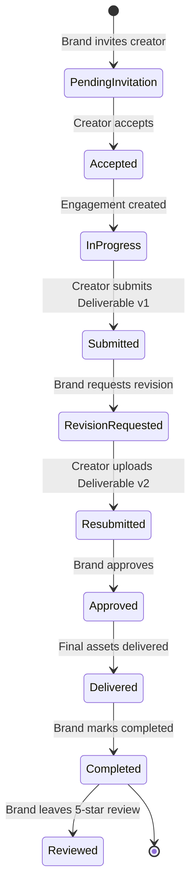

# CreaXa: AI Content Creator Marketplace

[](https://www.typescriptlang.org/)
[](https://react.dev/)
[](https://github.com/cloudflare/vinext)
[-orange.svg)](https://firebase.google.com/)
[](https://supabase.com/)
[](https://workers.cloudflare.com/)
[](https://threejs.org/)
[](https://playwright.dev/)

> **CreaXa** is an independent, AI-native creator marketplace engineered for the next generation of creative production. It connects AI filmmakers, animators, generative artists, and creative technologists with forward-thinking brands and creative agencies through explainable matching, transparent commercial licensing, and transactional project workspaces.

---

## 1. Definitive Architecture

| Architectural Layer | Technology | Implementation Details |
|---|---|---|
| **Website & Frontend** | Next.js 16 / React 19.2 / TypeScript | Server & Client Components, Responsive Editorial UI |
| **Edge Runtime** | Vinext / Cloudflare Workers | V8 edge isolates, sub-millisecond cold starts |
| **Primary Authentication** | **Firebase Authentication** | **Email/Password** and **Google OAuth** (*Microsoft excluded*) |
| **Primary Database** | **Supabase PostgreSQL** | 17 normalized tables, relational integrity, JSONB |
| **Database Security** | **PostgreSQL Row Level Security (RLS)** | Least-privilege policies verified via Firebase JWT claims |
| **Application Authorization** | Server-Side RBAC | Explicit Brand / Creator / Admin permission gates |
| **Object File Storage** | Cloudflare R2 | High-throughput asset hosting with MIME validation |
| **Creative AI Integration** | Server-Side OpenAI Integration | Structured `gpt-4.1-mini` brief extraction |
| **Creative 3D Visuals** | Three.js / WebGL | 5,600-particle ambient scene with Catmull-Rom camera |
| **Design System & Themes** | Vanilla CSS & Design Tokens | **All 10 curated themes** with persistent local storage |

---

## 2. Core Marketplace Capabilities

1. **Independent Brand Experience**: Clean, standalone marketplace branding without third-party promotional watermarks or platform badges.
2. **Firebase Authentication (Email & Google)**: Complete sign up and sign in supporting Email/Password and Google OAuth, with secure session syncing and password visibility controls. (*Microsoft authentication is completely removed from scope.*)
3. **Supabase PostgreSQL Persistence**: All marketplace records (accounts, profiles, portfolios, campaigns, briefs, invitations, deliverables, reviews) stored in Supabase PostgreSQL with robust RLS policies.
4. **Rich AI Creator Portfolios**: Verified model stacks (Runway, Kling, Flux, Midjourney), workflow notes, and media streaming backed by Cloudflare R2.
5. **Commercial-Use Rights Enforcement**: Explicit licensing declarations for every portfolio project and brand brief (territory, channels, exclusivity, third-party exclusions).
6. **Multi-Currency Budget Filtering**: Exact minor-unit arithmetic preventing naive cross-currency mismatches between INR, USD, and EUR.
7. **Explainable Creator Matching**: 7-dimension weighted matching algorithm providing transparent compatibility scores and clear explanations.
8. **Transactional Collaboration Workspaces**: A strict state machine governing the full engagement lifecycle: *Invitation → Acceptance → Submission v1 → Revision Request → Resubmission v2 → Approval → Delivery → Completion → 5-Star Reviews*.
9. **AI Brief Builder**: Server-side model integration transforming unstructured ideas into structured, editable campaign briefs with graceful manual fallback.
10. **Ten Curated Editorial Themes**: Bold typographic palettes with instant dynamic theme switching and synchronized Three.js WebGL particle aesthetics.

---

## 3. Seven-Scene Cinematic 3D Narrative

The scroll-driven experience (`app/intro/IntroExperience.tsx`) guides users through seven distinct visual chapters:

1. **Scene 1 — Hero: A New Creative Economy**: *Creative talent. Intelligently connected.* Central iridescent sculpture with connected brand and creator nodes; functional CTAs ("Explore creators" and "Start a campaign").
2. **Scene 2 — The Problem: Fragmented Discovery**: *The talent exists. The discovery is broken.* Disconnected nodes illustrate scattered platforms, unclear skills, and missing workflow context.
3. **Scene 3 — The Brief: Idea to Structure**: *From a rough idea to a real creative brief.* Floating abstract particles condense into organized campaign requirements (Style, Format, Aspect Ratio, Budget, Commercial Rights).
4. **Scene 4 — The Match: Creative Compatibility**: *Find the right creative mind.* Requirement vectors align with eligible creator nodes; explainable compatibility scoring (Style 30%, Tools 20%, Format 20%, Industry 15%, Budget 15%).
5. **Scene 5 — Portfolio Gallery**: *Work that speaks for itself.* Showcases real published creator image and video productions with declared AI toolchains and verified workflows.
6. **Scene 6 — Collaboration Workflow**: *From first connection to final delivery.* Traverses the 6-step project lifecycle: *Invite → Accept → Submit v1 → Revise → Approve → Deliver*.
7. **Scene 7 — Final Call to Action**: *Make something extraordinary.* Converging nodes resolve into the primary action dock: "Discover creators", "Join as a creator", and "Start a campaign".

---

## 4. Ten Editorial Themes

CreaXa features 10 hand-curated editorial themes designed for high aesthetic impact:
1. **Obsidian Editorial**: Sleek modern dark mode with titanium accents (`#11110F` / `#F2EEE5` / `#D95736`)
2. **Paper & Ink**: Minimalist, high-contrast monochrome monograph (`#F4F0E7` / `#232321` / `#B7432B`)
3. **Carbon Acid**: Tech-forward dark slate with vibrant electric lime (`#131715` / `#EDF3E6` / `#D4ED65`)
4. **Midnight Cobalt**: Deep electric blue inspired by modern cinema (`#09152B` / `#EEF1FC` / `#8BA8FF`)
5. **Terracotta Atelier**: Warm Mediterranean design studio earth tones (`#EBDCCE` / `#332720` / `#B85C3C`)
6. **Arctic Signal**: Clean, cool Scandinavian architectural palette (`#E8F1F0` / `#173337` / `#008C83`)
7. **Plum Archive**: Regal, nuanced deep violet and muted gold (`#21151F` / `#F4E9EF` / `#E4A0B9`)
8. **Industrial Mono**: Raw brutalist technical aesthetic (`#E6E5E0` / `#1B1B1B` / `#EF5836`)
9. **Analog Film**: Nostalgic sepia-tinted cinematic grading (`#29231C` / `#F3E8D2` / `#DBAB57`)
10. **Deep Teal Gallery**: Elegant museum gallery atmosphere (`#092D30` / `#F5F1E6` / `#F4AA78`)

Themes persist across browser sessions in `localStorage` and synchronize dynamically with the Three.js 3D canvas shader.

---

## 5. Full Collaboration Lifecycle



---

## 6. Development & Verification Guide

### Prerequisites
- Node.js `>= 22.13.0` (Node 24 LTS recommended)
- pnpm `>= 10.0.0`

### 1. Installation
```bash
pnpm install
```

### 2. Environment Configuration
Copy `.env.example` to `.env` and configure your credentials:
```bash
cp .env.example .env
```

### 3. Start Local Edge Dev Server
```bash
pnpm run dev
# Server available at http://127.0.0.1:5173/
```

### 4. Run Automated Test Suites
```bash
# Strict TypeScript Type Check (0 errors)
node node_modules/typescript/bin/tsc --noEmit --incremental false

# Multi-Currency Unit & SQL Verification (12 tests)
node scripts/verify-currency.mjs

# Marketplace API & Authorization Matrix (113 assertions)
node scripts/verify-marketplace.mjs

# 3D Three.js Catmull-Rom Scene Verification (201 samples, 5,600 particles)
node scripts/verify-intro.mjs

# Full-Stack End-to-End Collaboration Lifecycle (18 transactional steps)
node scripts/verify-live-flow.mjs

# Playwright Real Chrome Browser E2E Suite (10 themes, 3D hero, mobile viewport, Firebase UI)
node scripts/test-e2e-browser.mjs
```

### 5. Production Build
```bash
pnpm run build
```

---

## 7. Documentation Index

- [Implementation Audit](file:///c:/Users/ashuc/OneDrive/Desktop/CreaXa/docs/implementation-audit.md)
- [Firebase Authentication Setup Guide](file:///c:/Users/ashuc/OneDrive/Desktop/CreaXa/docs/firebase-setup.md)
- [Supabase PostgreSQL Setup Guide](file:///c:/Users/ashuc/OneDrive/Desktop/CreaXa/docs/supabase-setup.md)
- [D1 to Supabase Database Migration Plan](file:///c:/Users/ashuc/OneDrive/Desktop/CreaXa/docs/database-migration.md)
- [Supabase Row Level Security (RLS) Policies](file:///c:/Users/ashuc/OneDrive/Desktop/CreaXa/docs/rls-policies.md)
- [Animation & 7-Scene 3D System](file:///c:/Users/ashuc/OneDrive/Desktop/CreaXa/docs/animation-system.md)
- [Ten Editorial Themes System](file:///c:/Users/ashuc/OneDrive/Desktop/CreaXa/docs/theme-system.md)
- [Production Deployment Guide](file:///c:/Users/ashuc/OneDrive/Desktop/CreaXa/docs/deployment.md)
- [Comprehensive Test Results & Verification](file:///c:/Users/ashuc/OneDrive/Desktop/CreaXa/docs/test-results.md)
- [Known Limitations & Production Considerations](file:///c:/Users/ashuc/OneDrive/Desktop/CreaXa/docs/known-limitations.md)
- [Hackathon Demo & Evaluation Script](file:///c:/Users/ashuc/OneDrive/Desktop/CreaXa/docs/hackathon-demo.md)
- [Screenshots Directory](file:///c:/Users/ashuc/OneDrive/Desktop/CreaXa/docs/screenshots/)
