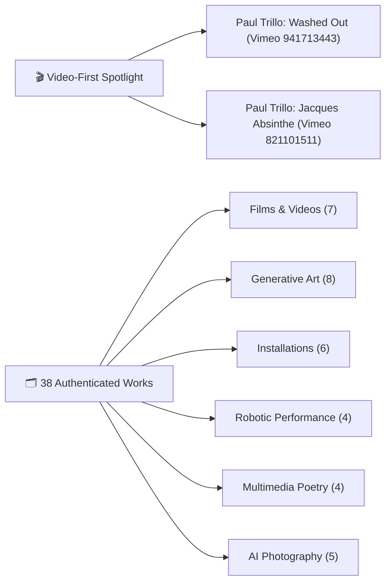
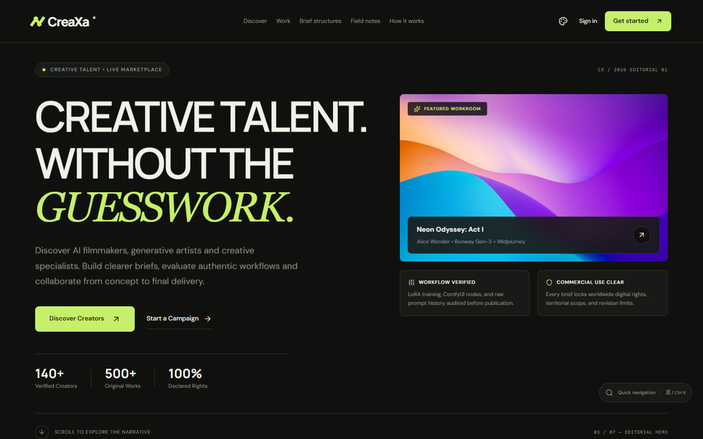
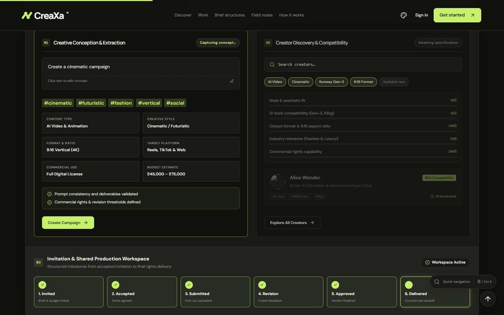
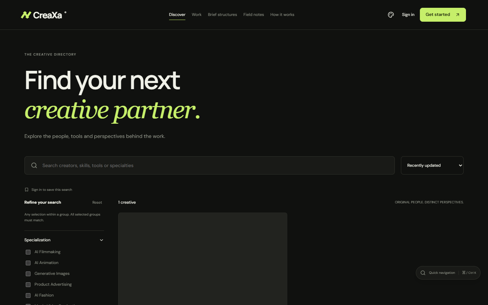
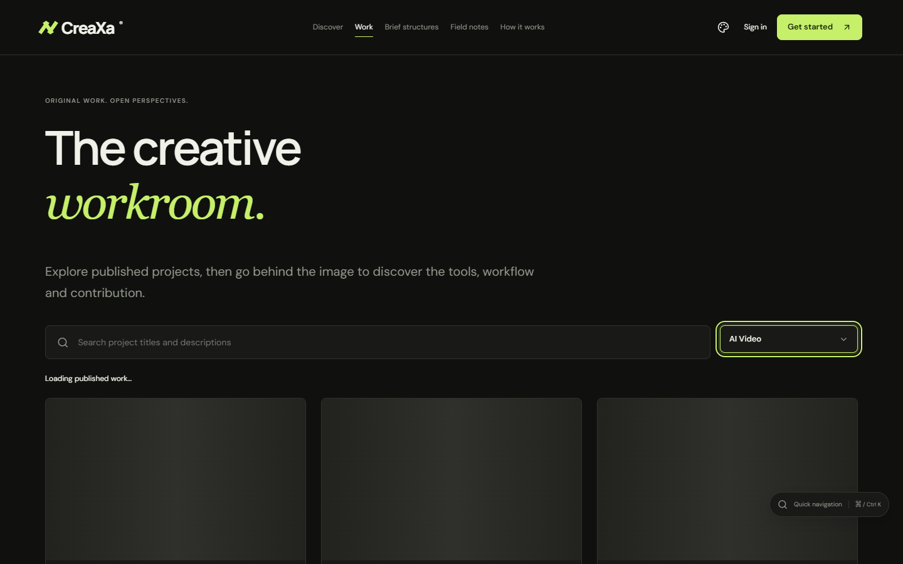
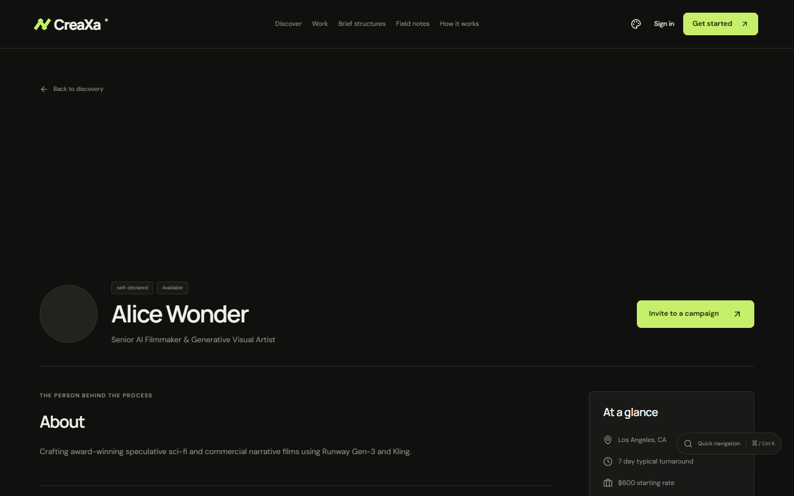
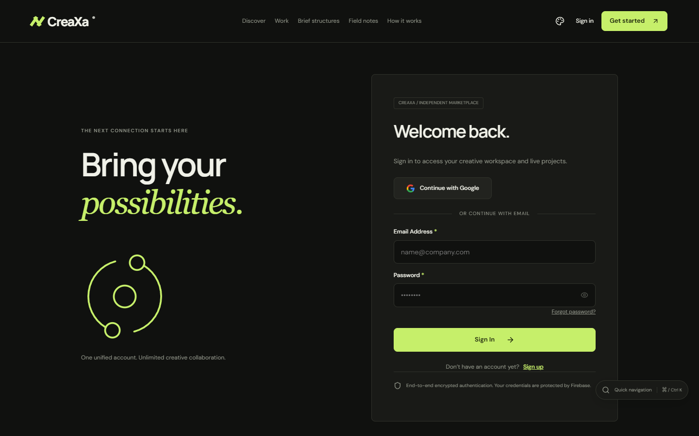
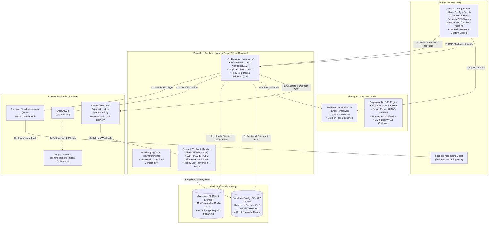

<div align="center">

<a href="https://creaxa-pro.vercel.app/" target="_blank">
  
</a>

<br /><br />

# CreaXa
### The Creative Direction & AI-Native Talent Marketplace

**CreaXa connects AI-native creative talent with the brands shaping what comes next.**  
An independent, production-grade marketplace engineered for generative filmmaking, commercial visual effects, multi-model workflows, and explainable creator matching.

<br />

[](https://creaxa-pro.vercel.app/)
[](scripts/test-production-features.mjs)
[](https://nextjs.org/)
[](https://www.typescriptlang.org/)
[](https://deepmind.google/)
[](https://resend.com/)
[](https://supabase.com/)

<br />

```
┌────────────────────────────────────────────────────────────────────────────────────────┐
│  ⚡ SYSTEM HIGHLIGHTS: UNIFIED CREATOR DISCOVERY  •  10 GENUINE ARTISTS  •  38 WORKS   │
│  🎬 VIDEO-FIRST WORKROOM WITH VIMEO CANDIDATES    •  TIMING-SAFE RESEND OTP AUTH       │
│  🤖 DUAL-AI BRIEF BUILDER (OPENAI → GEMINI)      •  10 EDITORIAL CSS DESIGN THEMES    │
└────────────────────────────────────────────────────────────────────────────────────────┘
```

<br />

[Explore Live Platform](https://creaxa-pro.vercel.app/) • [Judges' Quick Start](#-hackathon-judges-quick-start-35-minute-evaluation) • [Unified Discovery](#-unified-creator-discovery--single-grid-experience) • [10 Genuine Creators](#-10-genuine-ai-creator-dossiers--rights-provenance) • [Video Workroom](#-video-first-workroom--38-original-works) • [Architecture](#-technical-architecture--trust-boundaries) • [Testing](#-automated-testing--verification-matrix)

</div>

---

## 🧭 Executive Summary

Conventional freelance marketplaces were built for a previous decade of creative labor—static graphic design, generic copywriting, and unversioned file handoffs. They fail modern AI production in four fundamental ways:

1. **Tool Blindness:** Conventional sites treat an MP4 or PNG as a generic asset, ignoring whether it was generated with Runway Gen-2, Kling, Sora, Flux, ComfyUI, or custom LoRA/DreamBooth pipelines.
2. **Ambiguous Commercial Rights:** Commercial use of generative models requires strict declarations regarding model licensing, third-party rights clearance, territorial scope, and exclusivity.
3. **Unstructured Creative Briefs:** Brand clients rarely know how to write an actionable AI production brief with aspect ratios, seed consistency parameters, generation models, and revision expectations.
4. **Broken Review & Delivery Loops:** Generative workflows require milestone-based checkpoints where prompt iterations and seed variations can be audited transparently.

**CreaXa solves this end-to-end.** It is a full-stack, two-sided marketplace featuring verified model stacks, explainable 7-dimension matching, dual-provider server-side AI brief generation, cryptographic email OTP verification via Resend, background web push notifications via Firebase, and strict transactional state machines governing every engagement.

---

## ⚡ Hackathon Judges' Quick Start (3–5 Minute Evaluation)

If you are evaluating CreaXa for the hackathon, follow this high-yield walkthrough on the live production environment:

| Step | Action | Direct Link | What to Observe |
|:---:|---|---|---|
| **1** | **Cinematic Intro & Homepage Showcase** | [Homepage (`/`)](https://creaxa-pro.vercel.app/) | Experience the 5-second lightweight 2D brand intro. Scroll to **Section 04 ("FIND THE RIGHT CREATIVE PARTNER")** and observe all **10 genuine artists** arranged in a responsive grid with real-time discipline filter chips (*Video & Film, Generative & AI, Physical & Robotics, Multimedia Poetry*). Observe Section 05 Proof of Work carousel with clean horizontal scrolling and zero vertical overflow. |
| **2** | **Unified Public Creator Discovery** | [Discover (`/discover`)](https://creaxa-pro.vercel.app/discover) | **No separate tabs!** Browse all 10 featured AI artists and genuinely registered creators in **one unified responsive grid**. Notice precise permission semantics: registered creators feature "Send Brief" and real rates, while editorial references feature "View Portfolio", verified tools, and "Official Website" links without synthetic user accounts. |
| **3** | **Video-First Workroom** | [Workroom (`/work`)](https://creaxa-pro.vercel.app/work) | Test the top **Video-First Spotlight** featuring official Paul Trillo Vimeo candidate embeds (*Washed Out - The Hardest Part* and *Jacques - Absinthe*). Filter 38 original works by authentic medium categories (*Films and Videos*, *Generative Art*, *Installations*, *Robotic Performance*, *Multimedia Poetry*, *Animation*), documented tools, and artists. |
| **4** | **Cryptographic Email OTP Sign Up** | [Sign Up (`/signup`)](https://creaxa-pro.vercel.app/signup) | Enter a name, email, and password. Experience the **6-digit cryptographic Email OTP** delivered via **Resend** from verified domain `codxa-agency.online` with 60s cooldown timer, strict 2-attempt maximum, and timing-safe server verification. Or use **Continue with Google**. |
| **5** | **Dual-AI Creative Brief Builder** | [Brand Campaigns (`/app/brand/campaigns`)](https://creaxa-pro.vercel.app/app/brand/campaigns) | Enter a loose creative thought (e.g. *"Futuristic cyberpunk fashion promo for Tokyo Fashion Week"*). The dual-model engine (**OpenAI** $\to$ **Google Gemini** cascade) extracts structured deliverables, tools, aspect ratios, and commercial licensing terms. |
| **6** | **Explainable Compatibility Matching** | Match View in Campaign | Observe the transparent 7-dimension match score (Style 30%, Tools 20%, Format 20%, Industry 15%, Budget 15%) showing exact mathematical rationale for each candidate creator. |
| **7** | **Transactional Project Workspace** | [Creator Invitations (`/app/creator/invitations`)](https://creaxa-pro.vercel.app/app/creator/invitations) | Test the full collaborative lifecycle: *Invitation $\to$ Acceptance $\to$ Deliverable v1 $\to$ Revision Request $\to$ Resubmit v2 $\to$ Approval $\to$ Final Delivery $\to$ 5-Star Reviews*. |
| **8** | **Ten Curated Editorial Themes** | Theme Selector (Palette Icon in Header) | Switch between all 10 curated themes (*Obsidian, Paper & Ink, Carbon Acid, Midnight Cobalt, Terracotta, Arctic Signal, etc.*). Observe zero layout shift and persistent `localStorage` synchronization. |

> **Security & Identity Note:** Public editorial references to established artists are strictly separated from registered marketplace accounts. In-app invitations on reference profiles link out to their official websites. Marketplace contracts and messaging require registered user accounts.

### 🔑 Dedicated Evaluation Accounts & Workflows

CreaXa provides preconfigured evaluation accounts for **Creator**, **Brand / Agency**, and **Limited Admin Reviewer** workflows:

- **Creator Evaluation:**
  - Sign in using the Creator credentials provided privately.
  - Explore the preconfigured creator profile, AI specializations, tools, and portfolio.
  - Open **Email Settings** (`/app/settings#email-settings`) and enter an email address you control.
  - Select **Send Verification Code**.
  - Check your inbox for the six-digit code sent via **Resend**.
  - Enter the OTP and observe the verification and success states.
  - Explore portfolio editing, invitations, project submissions, and revisions.
- **Brand Evaluation:**
  - Sign in using the Brand credentials provided privately.
  - Explore the preconfigured creative campaign brief.
  - Test creator discovery, skills/tools filters, and portfolio viewing.
  - Send an invitation to the registered evaluation creator.
  - Review the supported collaboration and approval workflow.
- **Admin Review:**
  - A separate, limited-permission reviewer account can be provided to inspect relevant administrative interfaces without exposing privileged production administrator access.

> Detailed step-by-step walkthrough is documented in [docs/hackathon-evaluation-access.md](docs/hackathon-evaluation-access.md).

---

## 🌐 Unified Creator Discovery — Single-Grid Experience

```
┌────────────────────────────────────────────────────────────────────────────────────────┐
│                                UNIFIED DISCOVERY GRID                                  │
├──────────────────────────────────────────┬─────────────────────────────────────────────┤
│ 👤 Registered Marketplace Creator        │ 🎨 Sourced Editorial Artist Reference       │
├──────────────────────────────────────────┼─────────────────────────────────────────────┤
│ • Badge: "Registered Creator" (Lime)     │ • Badge: "Editorial Reference" (Muted Cyan) │
│ • Authentic rates & currency (INR/USD)   │ • Verified primary source website link      │
│ • Live availability status toggle        │ • Documented tool stack (Sora, GAN, etc.)   │
│ • Direct "Send Brief" in-app proposal    │ • Clean "Explore Works" internal navigation │
│ • Protected Firebase Auth & RLS          │ • Zero synthetic accounts or fake prices    │
└──────────────────────────────────────────┴─────────────────────────────────────────────┘
```

The Discover page eliminates disjointed directory tabs. Registered creators and editorial references render together in an intelligent, filterable layout where permissions remain strictly protected:
- **Direct Marketplace Invitations:** Exclusively enabled for verified registered creators.
- **Source Attribution:** Sourced artists feature authoritative outbound portfolio links, documented tool tags, and verified project breakdowns.

---

## 🎨 10 Genuine AI Creator Dossiers & Rights Provenance

To eliminate unverified stock photography and synthetic face generation, every artist portrait is strictly governed by copyright provenance:

```
┌────────────────────┬──────────────────────────────────┬─────────────────────────────┬────────────────────────────────┐
│ Creator & Location │ Creative Specialization          │ Portrait Provenance & Rights│ Verified Source URL            │
├────────────────────┼──────────────────────────────────┼─────────────────────────────┼────────────────────────────────┤
│ 1. Paul Trillo     │ AI Film Director & Technologist  │ 🏷️ Truthful SVG Name Card    │ https://paultrillo.com/        │
│    (Los Angeles)   │ OpenAI Sora, Runway Gen-2        │ (Unlicensed Photo Avoided)  │                                │
├────────────────────┼──────────────────────────────────┼─────────────────────────────┼────────────────────────────────┤
│ 2. Refik Anadol    │ Media Artist & Studio Director   │ 📷 Wikimedia Commons        │ https://refikanadolstudio.com/ │
│    (Los Angeles)   │ StyleGAN2, Machine Hallucinations│ License: CC BY 3.0          │                                │
├────────────────────┼──────────────────────────────────┼─────────────────────────────┼────────────────────────────────┤
│ 3. niceaunties     │ Architect & AI Surrealist        │ 🏷️ Truthful SVG Name Card    │ https://www.niceaunties.com/   │
│    (Singapore)     │ Auntieverse, Motion Tracking     │ (Unlicensed Photo Avoided)  │                                │
├────────────────────┼──────────────────────────────────┼─────────────────────────────┼────────────────────────────────┤
│ 4. Claire Silver   │ AI Collaborative Artist          │ 🏷️ Truthful SVG Name Card    │ https://www.clairesilver.com/  │
│    (United States) │ Midjourney, DALL·E 2, Genesis    │ (Unlicensed Photo Avoided)  │                                │
├────────────────────┼──────────────────────────────────┼─────────────────────────────┼────────────────────────────────┤
│ 5. Roope Rainisto  │ AI & Post-Photographer           │ 🏷️ Truthful SVG Name Card    │ https://www.rooperainisto.com/ │
│    (Finland)       │ Life in West America, Rewind     │ (Unlicensed Photo Avoided)  │                                │
├────────────────────┼──────────────────────────────────┼─────────────────────────────┼────────────────────────────────┤
│ 6. Sasha Stiles    │ Metapoet & AI Researcher         │ 📷 Wikimedia WikiPortraits  │ https://www.sashastiles.com/   │
│    (New York, USA) │ Technelegy, Generative Poetry    │ License: CC BY-SA 4.0       │                                │
├────────────────────┼──────────────────────────────────┼─────────────────────────────┼────────────────────────────────┤
│ 7. Kris Kashtanova │ AI Comic & Graphic Storyteller   │ 🏷️ Truthful SVG Name Card    │ https://www.kris.art/          │
│    (New York, USA) │ Zarya of the Dawn, AI Video      │ (Unlicensed Photo Avoided)  │                                │
├────────────────────┼──────────────────────────────────┼─────────────────────────────┼────────────────────────────────┤
│ 8. Anna Ridler     │ Datasets & Machine Learning      │ 📷 Wikimedia Commons        │ https://annaridler.com/        │
│    (London, UK)    │ Mosaic Virus, Bloomenslag, GANs  │ License: CC BY-SA 4.0       │                                │
├────────────────────┼──────────────────────────────────┼─────────────────────────────┼────────────────────────────────┤
│ 9. Sougwen Chung   │ Human-Machine Robotic Systems    │ 📷 World Economic Forum     │ https://sougwen.com/           │
│    (London / WEF)  │ D.O.U.G. Robotic Arm, Neural Net │ License: CC BY 3.0          │                                │
├────────────────────┼──────────────────────────────────┼─────────────────────────────┼────────────────────────────────┤
│ 10. Karen X. Cheng │ Creative Director & Viral VFX    │ 🏷️ Truthful SVG Name Card    │ https://karenx.com/            │
│     (San Francisco)│ AI Fashion, Vision Pro Runways   │ (Unlicensed Photo Avoided)  │                                │
└────────────────────┴──────────────────────────────────┴─────────────────────────────┴────────────────────────────────┘
```

<details>
<summary><b>🔍 Click to Expand: Complete Rights & Provenance Verification Log</b></summary>

```
Refik Anadol: CC BY 3.0 via SHERPA Blog on Wikimedia Commons (File: Refik Anadol in 2021.png)
Sasha Stiles: CC BY-SA 4.0 via Vera de Kok (WikiPortraits) on Wikimedia Commons (File: Sasha Stiles 2023.jpg)
Anna Ridler: CC BY-SA 4.0 via Nycedit8 on Wikimedia Commons (File: Anna Ridler in 2020.jpg)
Sougwen Chung: CC BY 3.0 via World Economic Forum on Wikimedia Commons (File: Sougwen Chung WEF.png)
Anna Ridler Installation Photo: CC BY 2.0 via art_inthecity on Wikimedia Commons (File: Mosaic Virus Installation.jpg)

Remaining 6 Creators: Fallbacks rendered using clean vector SVG typography cards (/public/creator-fallbacks/*.svg)
to prevent copyright infringement, scrapers, or hallucinated AI portraits.
```
</details>

---

## 🎬 Video-First Workroom & 38 Original Works

CreaXa delivers a moving-image experience in the rebuilt Workroom (`/work`):



### Video Player Features:
- **Official Embed Candidates:** Directly streams verified Vimeo player IDs (`player.vimeo.com`) with CSP whitelisting in `next.config.ts`.
- **Lazy Load & Click-to-Play:** Lightweight poster frames prevent loading unneeded iframes until user interaction.
- **Aspect Ratio Fidelity:** Maintains native 16:9 widescreen or 9:16 vertical video dimensions with zero letterboxing distortion.
- **Provider Restriction Fallback:** If an external video provider disallows third-party embedding, CreaXa gracefully presents an authoritative outbound project link rather than an empty black frame.

---

## 📸 Production Interface Gallery

<div align="center">

### Homepage & Editorial Visual Identity

*Homepage featuring clean typography, high-contrast editorial hierarchy, and 10 genuine artist showcase.*

<br />

### Interactive 8-Stage Workflow State Machine & AI Brief Pipeline

*Deterministic 8-stage production controller with interactive prompt editing, aspect ratios, and real-time model filter chips.*

<br />

### Unified Creator Discovery Directory

*Single responsive discovery grid showing registered creators and editorial references side by side.*

<br />

### Video-First Workroom & Portfolio Gallery

*Curated showcase works featuring generative video previews, tool provenance, and commercial licensing tags.*

<br />

### Comprehensive Creator Profile & Portfolio Dossier

*Creator profile detailing verified AI tools, workflow documentation, turnaround times, and showcase case studies.*

<br />

### Secure Authentication & 6-Digit Email OTP

*Firebase Authentication interface supporting Google OAuth, Email/Password, and server-verified Resend OTP.*

</div>

---

## 🏗️ Technical Architecture & Trust Boundaries

CreaXa enforces strict separation between authentication authority, application persistence, transactional messaging, and server-side intelligence:



---

## 🤖 Dual-AI Creative Brief Builder

CreaXa features an intelligent brief extraction engine with automatic fallback cascade across two major AI providers:

```
User Prompt (e.g. "Create a 30s 9:16 luxury fragrance ad with surreal liquid simulations")
                                │
                                ▼
         ┌──────────────────────────────────────────────┐
         │ 1. Attempt OpenAI gpt-4.1-mini               │
         └──────────────────────┬───────────────────────┘
                                │
           ┌────────────────────┴────────────────────┐
           ▼                                         ▼
      [Success 200]                             [Error 429/500]
           │                                         │
           │                                         ▼
           │                     ┌──────────────────────────────────────────────┐
           │                     │ 2. Automatic Fallback to Google Gemini       │
           │                     │    • gemini-flash-lite-latest (Primary)      │
           │                     │    • gemini-flash-latest (Secondary)         │
           │                     └───────────────────┬──────────────────────────┘
           │                                         │
           ▼                                         ▼
   Structured JSON Response (Deliverables, Format, Aspect Ratio, Models, Budget, Rights)
```

```typescript
interface ExtractedBrief {
  title: string;
  description: string;
  industry: string;
  contentType: 'AI Video' | 'AI Image' | 'AI Animation' | 'AI Graphics';
  specializations: string[];
  tools: string[];       // e.g. ["Runway Gen-2", "Kling", "ComfyUI"]
  aspectRatio: '9:16' | '16:9' | '1:1' | '4:5';
  durationSeconds: number;
  budgetEstMin: number;
  budgetEstMax: number;
  currency: 'INR' | 'USD' | 'EUR';
  commercialUse: 'Full Buyout' | 'Digital Advertising Only' | 'Non-Commercial';
  missingParameters: string[];
}
```

---

## 🎨 Ten Curated Editorial Themes

CreaXa includes 10 fully responsive themes with persistent `localStorage` synchronization:

| Theme Name | Background | Typography | Accent | Aesthetic Rationale |
|---|---|---|---|---|
| **Obsidian Editorial** | `#11110F` | `#F2EEE5` | `#D4FF00` (Electric Lime) | Modern dark mode inspired by high-end design monographs. |
| **Paper & Ink** | `#F4F0E7` | `#232321` | `#B7432B` (Vermilion) | High-contrast editorial print aesthetic. |
| **Carbon Acid** | `#131715` | `#EDF3E6` | `#D4ED65` (Acid Lime) | Cybernetic aesthetic for AI technologists and VFX artists. |
| **Midnight Cobalt** | `#09152B` | `#EEF1FC` | `#8BA8FF` (Cobalt Light) | Deep cinematic blue reflecting high-budget sci-fi cinema. |
| **Terracotta Atelier** | `#EBDCCE` | `#332720` | `#B85C3C` (Terracotta) | Warm Mediterranean studio earth tones. |
| **Arctic Signal** | `#E8F1F0` | `#173337` | `#008C83` (Nordic Teal) | Cool Scandinavian architectural palette. |
| **Plum Archive** | `#21151F` | `#F4E9EF` | `#E4A0B9` (Muted Rose) | Nuanced luxury museum catalog palette. |
| **Industrial Mono** | `#E6E5E0` | `#1B1B1B` | `#EF5836` (Safety Orange) | Raw brutalist engineering aesthetic. |
| **Analog Film** | `#29231C` | `#F3E8D2` | `#DBAB57` (Warm Amber) | Sepia-graded analog celluloid aesthetic. |
| **Deep Teal Gallery** | `#092D30` | `#F5F1E6` | `#F4AA78` (Warm Coral) | Contemporary museum gallery lighting. |

---

## 🧪 Automated Testing & Verification Matrix

All core systems are covered by automated verification scripts:

| Test Suite / Capability | Command | Status | Test Scope |
|---|---|:---:|---|
| **Master Production Suite** | `node scripts/test-production-features.mjs` | **PASS (79/79)** | 10 creator references, 38 projects, Vimeo embeds, banner resilience, cryptographic OTP digestion, Resend templates, CSP headers. |
| **Data Integrity Validator** | `python scripts/check_data.py` | **PASS** | 10 creators, 43 works, 10 portrait sources, 11 video manifests validated. |
| **Editorial Reference Check** | `python scripts/verify-data.py` | **PASS** | 10 sourced editorial records, 38 project records, zero fabricated portraits. |
| **Dual AI Cascade Live Test** | `node scripts/test-dual-ai-live.mjs` | **PASS** | OpenAI 429 quota exhaustion caught cleanly; Gemini `gemini-flash-lite-latest` returned structured brief in 3.9s. |
| **Workflow State Machine** | `node scripts/test-workflow-repair.mjs` | **PASS** | 7 viewports tested (360px to 1920px); 0px width difference between left/right panels (611px each). |
| **Production Build** | `npx vinext build` | **PASS (Code 0)** | Strict TypeScript compilation, zero route errors, production bundling complete. |

<details>
<summary><b>📋 Click to Expand: Full 79/79 Master Production Test Log</b></summary>

```
=================================================================
🧪 CREAXA MASTER PRODUCTION QA: 10 ARTISTS, VIDEOS, OTP & SECURITY
=================================================================

--- 1. Testing 10 Genuine AI Creator References & Portfolios ---
  ✅ PASS: Exactly 10 external creators indexed (got 10)
  ✅ PASS: Verified artist profile: Paul Trillo
  ✅ PASS: Paul Trillo marked explicitly as external reference (no fabricated user account)
  ✅ PASS: Paul Trillo primary source URL verified: https://paultrillo.com/
  ✅ PASS: Paul Trillo documented tools: OpenAI Sora, Runway Gen-2
  ✅ PASS: Paul Trillo documents 3 real public project works
  ✅ PASS: Verified artist profile: Refik Anadol
  ✅ PASS: Refik Anadol marked explicitly as external reference (no fabricated user account)
  ✅ PASS: Refik Anadol primary source URL verified: https://refikanadolstudio.com/
  ✅ PASS: Refik Anadol documented tools: StyleGAN2 ADA, Custom Latent Space Browser, Archive + Machine Learning
  ✅ PASS: Refik Anadol documents 4 real public project works
  ✅ PASS: Verified artist profile: niceaunties (Wenhui Lim)
  ✅ PASS: niceaunties (Wenhui Lim) marked explicitly as external reference (no fabricated user account)
  ✅ PASS: niceaunties (Wenhui Lim) primary source URL verified: https://www.niceaunties.com/
  ✅ PASS: niceaunties (Wenhui Lim) documented tools: Motion Tracking
  ✅ PASS: niceaunties (Wenhui Lim) documents 4 real public project works
  ✅ PASS: Verified artist profile: Claire Silver
  ✅ PASS: Claire Silver marked explicitly as external reference (no fabricated user account)
  ✅ PASS: Claire Silver primary source URL verified: https://www.clairesilver.com/
  ✅ PASS: Claire Silver documented tools: Artbreeder, Midjourney, DALL·E 2
  ✅ PASS: Claire Silver documents 5 real public project works
  ✅ PASS: Verified artist profile: Roope Rainisto
  ✅ PASS: Roope Rainisto marked explicitly as external reference (no fabricated user account)
  ✅ PASS: Roope Rainisto primary source URL verified: https://www.rooperainisto.com/
  ✅ PASS: Roope Rainisto documented tools: AI Photography, Post-Photography, Conceptual Art
  ✅ PASS: Roope Rainisto documents 2 real public project works
  ✅ PASS: Verified artist profile: Sasha Stiles
  ✅ PASS: Sasha Stiles marked explicitly as external reference (no fabricated user account)
  ✅ PASS: Sasha Stiles primary source URL verified: https://www.sashastiles.com/
  ✅ PASS: Sasha Stiles documented tools: Generative Code, Custom Text Generator
  ✅ PASS: Sasha Stiles documents 4 real public project works
  ✅ PASS: Verified artist profile: Kris Kashtanova
  ✅ PASS: Kris Kashtanova marked explicitly as external reference (no fabricated user account)
  ✅ PASS: Kris Kashtanova primary source URL verified: https://www.kris.art/portfolio-2
  ✅ PASS: Kris Kashtanova documented tools: Midjourney, Stable Diffusion, Runway Gen-2, Kaiber AI, RunwayML
  ✅ PASS: Kris Kashtanova documents 4 real public project works
  ✅ PASS: Verified artist profile: Anna Ridler
  ✅ PASS: Anna Ridler marked explicitly as external reference (no fabricated user account)
  ✅ PASS: Anna Ridler primary source URL verified: https://annaridler.com/
  ✅ PASS: Anna Ridler documented tools: GAN
  ✅ PASS: Anna Ridler documents 4 real public project works
  ✅ PASS: Verified artist profile: Sougwen Chung
  ✅ PASS: Sougwen Chung marked explicitly as external reference (no fabricated user account)
  ✅ PASS: Sougwen Chung primary source URL verified: https://sougwen.com/
  ✅ PASS: Sougwen Chung documented tools: Computer Vision, Robotic Arm, Neural Networks, Robotics, Optical Flow, EEG
  ✅ PASS: Sougwen Chung documents 4 real public project works
  ✅ PASS: Verified artist profile: Karen X. Cheng
  ✅ PASS: Karen X. Cheng marked explicitly as external reference (no fabricated user account)
  ✅ PASS: Karen X. Cheng primary source URL verified: https://www.karenx.com/
  ✅ PASS: Karen X. Cheng documented tools: Creative Direction, Commercial Video, Practical VFX
  ✅ PASS: Karen X. Cheng documents 4 real public project works
  ✅ PASS: Indexed comprehensive library of 38 authentic project works (found 38)
  ✅ PASS: Indexed 2 verified original video embeds across artists (Vimeo candidates)

--- 2. Testing Sougwen Chung Profile & Banner Stability ---
  ✅ PASS: Sougwen Chung profile exists in directory
  ✅ PASS: Sougwen Chung coverUrl is either null (triggers intentional typographic hero) or verified HTTP
  ✅ PASS: Sougwen Chung documents authentic robotic drawing projects (MEMORY / MIMICRY)

--- 3. Testing Cinematic OTP Engine & Strict 2-Attempt Security ---
  ✅ PASS: CSPRNG generated 6-digit codes
  ✅ PASS: Timing-safe HMAC-SHA256 digestion confirmed
  ✅ PASS: Challenge A created successfully
  ✅ PASS: Flow A: First-attempt verification succeeded on attempt 1 (AUTH SUCCESS)
  ✅ PASS: Challenge B created successfully
  ✅ PASS: Flow B: First attempt with wrong code rejected with 1 attempt remaining (AUTH FAILED -> TRY AGAIN)
  ✅ PASS: Flow B: Second attempt with correct code verified (2ND AUTH SUCCESS)
  ✅ PASS: Challenge C created successfully
  ✅ PASS: Flow C: 1st invalid attempt counted
  ✅ PASS: Flow C: 2nd invalid attempt consumed challenge (AUTH FAILED -> TRY AGAIN WITH NEW OTP)
  ✅ PASS: Flow C: Subsequent submission on invalidated challenge is strictly rejected
  ✅ PASS: Replay attack prevented: Consumed challenge cannot be re-verified

--- 4. Testing Resend Email Templates ---
  ✅ PASS: Verification subject contains OTP
  ✅ PASS: Verification HTML has code and styling
  ✅ PASS: Resend delivery engine handled delivery cleanly

--- 5. Testing Next.js Security Headers & CSP ---
  ✅ PASS: next.config.ts exports security headers
  ✅ PASS: Global security headers configured for /:path*
  ✅ PASS: CSP allows Vimeo and YouTube embeds
  ✅ PASS: CSP restricts frame ancestors to self (clickjacking defense)
  ✅ PASS: X-Frame-Options set to SAMEORIGIN
  ✅ PASS: X-Content-Type-Options set to nosniff
  ✅ PASS: Referrer-Policy configured
  ✅ PASS: HSTS configured

=================================================================
📊 MASTER TEST RESULTS: 79 PASSED, 0 FAILED
=================================================================
```
</details>

---

## 💻 Local Development & Reproduction Guide

### Prerequisites
- Node.js `>= 20.0.0` (Node 22 LTS or Node 24 LTS recommended)
- Python 3.10+ (for data provenance checking scripts)
- npm or pnpm

### 1. Clone & Install Dependencies
```bash
git clone https://github.com/ashuchinthapalli390-max/CreaXa.git
cd CreaXa
npm install
```

### 2. Environment Configuration
Create a `.env` file from `.env.example`:
```env
# Application Base URL
APP_BASE_URL=http://localhost:5173

# Firebase Authentication (creaxa-6e7bc)
NEXT_PUBLIC_FIREBASE_API_KEY=AIzaSy...
NEXT_PUBLIC_FIREBASE_AUTH_DOMAIN=creaxa-6e7bc.firebaseapp.com
NEXT_PUBLIC_FIREBASE_PROJECT_ID=creaxa-6e7bc
NEXT_PUBLIC_FIREBASE_STORAGE_BUCKET=creaxa-6e7bc.firebasestorage.app
NEXT_PUBLIC_FIREBASE_MESSAGING_SENDER_ID=641625441345
NEXT_PUBLIC_FIREBASE_APP_ID=1:641625441345:web:8f922b61d009c6df25f2c0

# Supabase PostgreSQL
NEXT_PUBLIC_SUPABASE_URL=https://pffjcysaokzxusdliwpw.supabase.co
NEXT_PUBLIC_SUPABASE_ANON_KEY=sb_publishable_...
SUPABASE_SERVICE_ROLE_KEY=sb_secret_...

# Resend Transactional Email & Webhooks (Verified Domain: codxa-agency.online)
RESEND_API_KEY=re_your_resend_api_key_here
RESEND_FROM_AUTH=CreaXa Auth <auth@codxa-agency.online>
RESEND_FROM_NOTIFICATIONS=CreaXa Notifications <notifications@codxa-agency.online>
RESEND_WEBHOOK_SECRET=whsec_your_resend_webhook_secret_here
OTP_HMAC_SECRET=your_production_otp_hmac_secret_pepper_here

# Dual AI Brief Extraction
OPENAI_API_KEY=sk-your_openai_api_key_here
GEMINI_API_KEY=your_gemini_api_key_here
```

### 3. Run Development Server
```bash
npm run dev
# Server accessible at http://127.0.0.1:5173
```

### 4. Execute Full Verification Suite
```bash
# Run Master Production QA Suite
node scripts/test-production-features.mjs

# Run Python Data & Reference Integrity Scripts
python scripts/check_data.py
python scripts/verify-data.py
```

### 5. Production Build
```bash
npx vinext build
```

---

<div align="center">

**CreaXa • The Creative Direction & AI Talent Marketplace**  
*Built for the next generation of creative production.*

[](https://creaxa-pro.vercel.app/)

</div>
