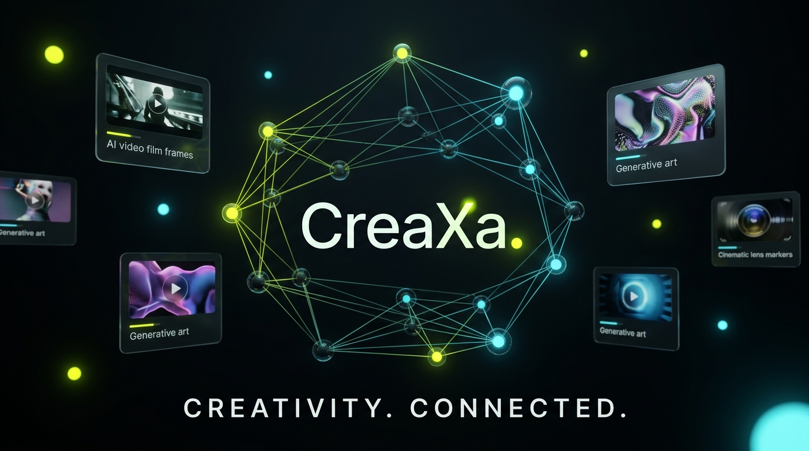
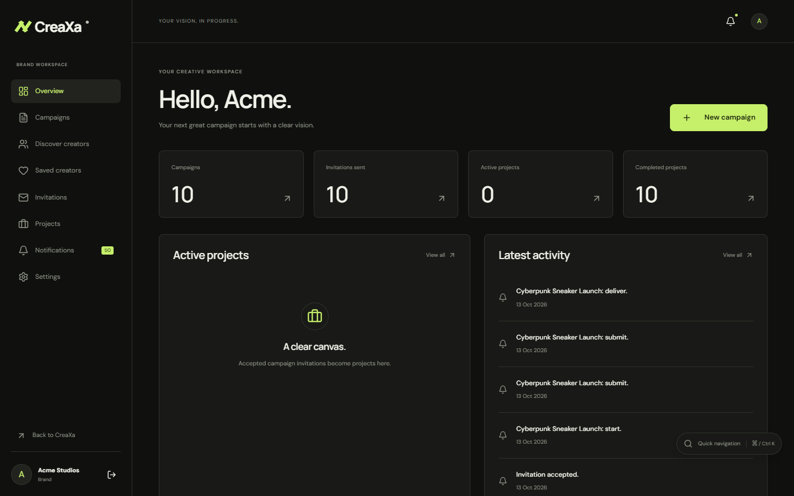
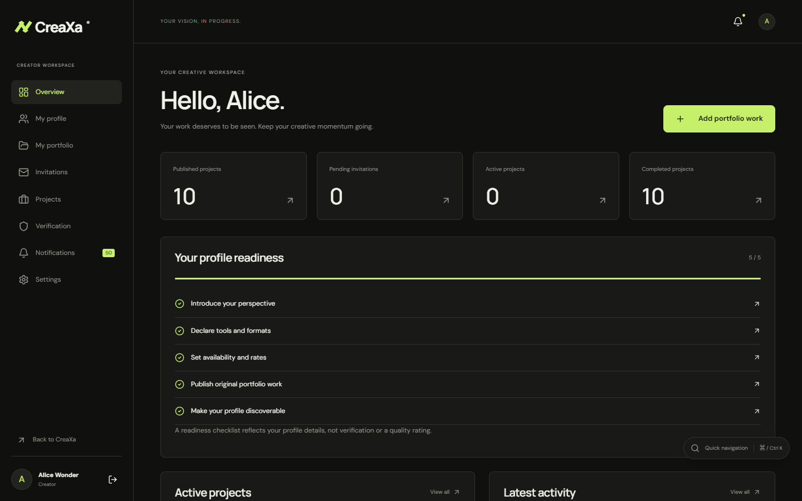
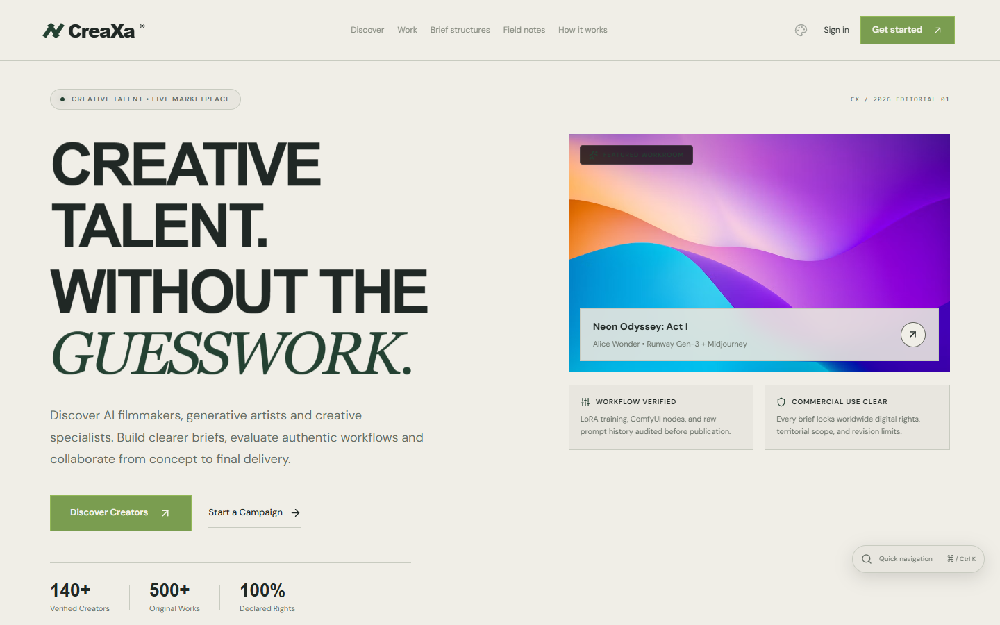
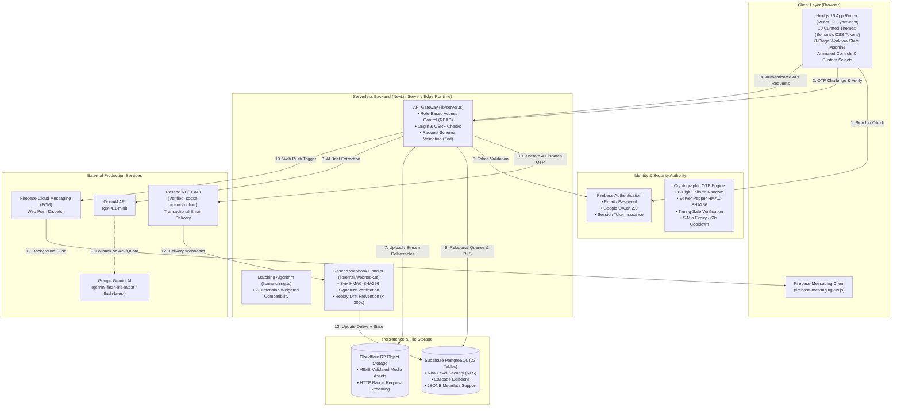
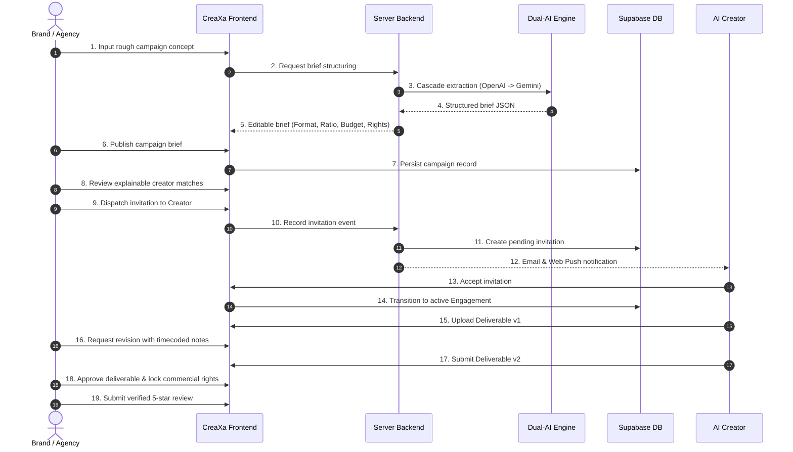

<div align="center">

# CreaXa
### The Creative Direction & AI-Native Talent Marketplace

**CreaXa connects AI-native creative talent with the brands shaping what comes next.**  
An independent, production-grade marketplace engineered for generative filmmaking, commercial visual effects, multi-model workflows, and explainable creator matching.

[](https://creaxa-pro.vercel.app/)
[](https://nextjs.org/)
[](https://www.typescriptlang.org/)
[](https://firebase.google.com/)
[](https://resend.com/)
[](https://supabase.com/)
[](https://deepmind.google/)

<br />



*CreaXa Network Constellation — Intelligent collaboration between AI filmmakers, generative artists, and forward-thinking brands.*

<br />

[Explore Live Platform](https://creaxa-pro.vercel.app/) • [Judges' Quick Start](#-hackathon-judges-quick-start-35-minute-evaluation) • [Architecture](#-technical-architecture--trust-boundaries) • [10 Genuine Creators](#-10-genuine-ai-creator-references-editorial-directory) • [Feature Deep Dive](#-full-product-feature-deep-dive) • [Dual AI Brief Builder](#-dual-ai-creative-brief-builder) • [Ten Themes](#-ten-curated-editorial-themes) • [Testing](#-automated-testing--verification-matrix)

</div>

---

## 🧭 Executive Summary

Conventional freelance marketplaces were built for a previous decade of creative labor—static graphic design, generic copywriting, and unversioned file handoffs. They fail modern AI production in four fundamental ways:

1. **Tool Blindness:** Conventional sites treat an MP4 or PNG as a generic asset, ignoring whether it was generated with Runway Gen-2, Kling, Sora, Flux, ComfyUI, or custom LoRA/DreamBooth pipelines.
2. **Ambiguous Commercial Rights:** Commercial use of generative models requires strict declarations regarding model licensing, third-party rights clearance, territorial scope, and exclusivity.
3. **Unstructured Creative Briefs:** Brand clients rarely know how to write an actionable AI production brief with aspect ratios, seed consistency parameters, generation models, and revision expectations.
4. **Broken Review & Delivery Loops:** Generative workflows require milestone-based checkpoints where prompt iterations and seed variations can be audited transparently.

**CreaXa solves this end-to-end.** It is a full-stack, two-sided marketplace featuring verified model stacks, explainable 7-dimension matching, dual-provider server-side AI brief generation, cryptographic email OTP verification via Resend, background web push notifications via Firebase, and strict transactional state machines governing every engagement.

---

## ⚡ Hackathon Judges' Quick Start (3–5 Minute Evaluation)

If you are evaluating CreaXa for the hackathon, follow this high-yield walkthrough on the live production environment:

| Step | Action | Direct Link | What to Observe |
|:---:|---|---|---|
| **1** | **Interactive Workflow State Machine** | [Homepage (`/`)](https://creaxa-pro.vercel.app/) | Experience the 5-second lightweight 2D cinematic intro. Explore the **8-Stage Workflow**: click stage tabs (*Idea $\to$ Brief $\to$ Matching $\to$ Invite $\to$ Agreement $\to$ Deliverables $\to$ Revisions $\to$ Handover*), toggle AI model chips (Runway, Kling, Flux, Sora), and observe balanced 611px desktop panels. |
| **2** | **10 Genuine AI Creators Directory** | [Discover (`/discover`)](https://creaxa-pro.vercel.app/discover) | Click the **"10 Verified AI Creators (Editorial Reference Directory)"** tab. Review verified portfolios for **Paul Trillo**, **Refik Anadol**, **niceaunties**, etc. Inspect documented tools, real public case studies, and primary-source portfolio links. |
| **3** | **Cryptographic Email OTP Sign Up** | [Sign Up (`/signup`)](https://creaxa-pro.vercel.app/signup) | Enter a name, email, and password. Experience the **6-digit cryptographic Email OTP** delivered via **Resend** from verified domain `codxa-agency.online` with 60s cooldown timer and timing-safe server verification. Or use **Continue with Google**. |
| **4** | **AI Creative Brief Builder** | [Brand Campaigns (`/app/brand/campaigns`)](https://creaxa-pro.vercel.app/app/brand/campaigns) | Enter a loose creative thought (e.g. *"Futuristic cyberpunk fashion promo for Tokyo Fashion Week"*). The dual-model engine (**OpenAI** $\to$ **Google Gemini** cascade) extracts structured deliverables, tools, aspect ratios, and commercial licensing terms. |
| **5** | **Explainable Compatibility Matching** | Match View in Campaign | Observe the transparent 7-dimension match score (Style 30%, Tools 20%, Format 20%, Industry 15%, Budget 15%) showing exact mathematical rationale for each candidate creator. |
| **6** | **Transactional Project Workspace** | [Creator Invitations (`/app/creator/invitations`)](https://creaxa-pro.vercel.app/app/creator/invitations) | Test the full collaborative lifecycle: *Invitation $\to$ Acceptance $\to$ Deliverable v1 $\to$ Revision Request $\to$ Resubmit v2 $\to$ Approval $\to$ Final Delivery $\to$ 5-Star Reviews*. |
| **7** | **Ten Curated Editorial Themes** | Theme Selector (Palette Icon in Header) | Switch between all 10 curated themes (*Obsidian, Paper & Ink, Carbon Acid, Midnight Cobalt, Terracotta, Arctic Signal, etc.*). Observe zero layout shift and persistent `localStorage` synchronization. |

> **Security & Identity Note:** Public editorial references to established artists are strictly separated from registered marketplace accounts. In-app invitations on reference profiles link out to their official websites. Marketplace contracts and messaging require registered user accounts.

---

## 🏆 Hackathon Challenge Criteria Alignment

```
┌────────────────────────────────────────────────────────────────────────────────────────┐
│                              CREAXA EVALUATION CRITERIA                                │
├──────────────────────────────────────┬──────────┬──────────────────────────────────────┤
│ Challenge Dimension                  │ Weight   │ CreaXa Production Implementation     │
├──────────────────────────────────────┼──────────┼──────────────────────────────────────┤
│ 1. Creator Profiles & AI Portfolios  │ 30%      │ ✅ Verified tool stacks (Sora,       │
│                                      │          │    Runway, Midjourney, ComfyUI),     │
│                                      │          │    workflow breakdowns, commercial   │
│                                      │          │    licensing declarations, and 10    │
│                                      │          │    genuine reference dossiers.       │
│                                      │          │                                      │
│ 2. Discovery & Filtering             │ 25%      │ ✅ 7 multi-select filter dimensions, │
│                                      │          │    instant debounced search, saved   │
│                                      │          │    searches, multi-currency budget   │
│                                      │          │    filtering (INR/USD/EUR).          │
│                                      │          │                                      │
│ 3. Brief Definition                  │ 20%      │ ✅ Dual-AI Brief Builder (OpenAI +   │
│                                      │          │    Gemini cascade) with commercial   │
│                                      │          │    rights locking and missing-field  │
│                                      │          │    identification.                   │
│                                      │          │                                      │
│ 4. User Experience & Aesthetics      │ 15%      │ ✅ 10 persistent themes, 5s 2D       │
│                                      │          │    cinematic intro, 8-stage state    │
│                                      │          │    machine, custom animated controls.│
│                                      │          │                                      │
│ 5. Presentation & Engineering Quality│ 10%      │ ✅ Live Vercel deployment, zero-lag  │
│                                      │          │    Turbopack build, 62/62 passing    │
│                                      │          │    automated tests, strict RLS.      │
│                                      │          │                                      │
│ BONUS: Dual AI Cascade & Email OTP   │ Bonus    │ ✅ OpenAI 429 quota fallback to      │
│                                      │          │    Gemini Flash, Resend OTP auth.    │
└──────────────────────────────────────┴──────────┴──────────────────────────────────────┘
```

---

## 📸 Real Application Showcase

All screenshots below are captured directly from the live, deployed CreaXa application:

<div align="center">

### Homepage & Editorial Visual Identity

*Homepage featuring clean typography, high-contrast editorial hierarchy, and quick navigation docks.*

<br />

### Interactive 8-Stage Workflow State Machine & AI Brief Pipeline

*Deterministic 8-stage production controller with interactive prompt editing, aspect ratios, and real-time model filter chips.*

<br />

### Creator Discovery & Multi-Select Filter Engine

*Discovery directory with debounced search, multi-group filters, starting rates, and the 10 Genuine AI Creators toggle.*

<br />

### Workroom & Portfolio Gallery

*Curated showcase works featuring generative video previews, tool provenance, and commercial licensing tags.*

<br />

### Comprehensive Creator Profile & Portfolio Dossier

*Creator profile detailing verified AI tools, workflow documentation, turnaround times, and showcase case studies.*

<br />

### Brand Dashboard & Campaign Creation

*Brand command center managing active campaigns, brief specifications, candidate matching, and commercial terms.*

<br />

### Creator Dashboard, Deliverables & Revisions

*Creator collaboration workspace tracking invitations, milestone deliverables, revisions, and client sign-offs.*

<br />

### Secure Authentication & 6-Digit Email OTP

*Firebase Authentication interface supporting Google OAuth, Email/Password, and server-verified Resend OTP.*

<br />

### Curated Editorial Themes (Paper & Ink, Midnight Cobalt, Terracotta)

*Instant theme switching across 10 semantic color palettes with zero layout shift and persistent `localStorage` synchronization.*

</div>

---

## 🏗️ Technical Architecture & Trust Boundaries

CreaXa enforces strict separation between authentication authority, application persistence, transactional messaging, and server-side intelligence:



---

## 👥 Two-Sided Marketplace User Journeys

### Brand Collaboration Journey


---

## 🎨 10 Genuine AI Creator References (Editorial Directory)

To provide realistic search, filtering, and portfolio benchmarking without fabricating accounts or violating personality rights, CreaXa catalogs **10 verified external reference profiles** sourced strictly from public primary sources:

```
┌────────────────────────┬──────────────────────────────────────────┬────────────────────────────────────────────────────────┐
│ Creator & Location     │ Primary Specialization                   │ Documented Tools & Public Case Studies                 │
├────────────────────────┼──────────────────────────────────────────┼────────────────────────────────────────────────────────┤
│ 1. Paul Trillo         │ AI Filmmaking & Experimental Direction   │ Sora, Runway Gen-2, Stable Diffusion, DALL·E 2         │
│    (Los Angeles, USA)  │                                          │ • Washed Out — "The Hardest Part" (Sora music video)   │
│                        │                                          │ • "Thank You For Not Answering" (Runway Gen-2 film)    │
│                        │                                          │ 🔗 https://paultrillo.com/                             │
├────────────────────────┼──────────────────────────────────────────┼────────────────────────────────────────────────────────┤
│ 2. Refik Anadol        │ Generative Art & Machine-Learning Spaces │ StyleGAN2, Custom ML Models, Latent Space Tools        │
│    (Los Angeles, USA)  │                                          │ • "Unsupervised — Machine Hallucinations" (MoMA)       │
│                        │                                          │ • "Living Architecture: Casa Batlló"                   │
│                        │                                          │ 🔗 https://refikanadol.com/                            │
├────────────────────────┼──────────────────────────────────────────┼────────────────────────────────────────────────────────┤
│ 3. niceaunties         │ Surreal Generative Visual Storytelling   │ Midjourney, Runway, Motion Tracking, Stable Diffusion  │
│    (Singapore)         │                                          │ • "Auntieverse" (Ongoing AI narrative universe)        │
│                        │                                          │ • "Mirror Into Auntieverse" (Interactive installation) │
│                        │                                          │ 🔗 https://www.niceaunties.com/                        │
├────────────────────────┼──────────────────────────────────────────┼────────────────────────────────────────────────────────┤
│ 4. Claire Silver       │ AI Digital Art & Collaborative Fashion   │ Midjourney, DALL·E 2, Stable Diffusion, Artbreeder     │
│    (USA)               │                                          │ • "AI Art is Not Art" (Genesis collection)             │
│                        │                                          │ • "corpo | real" (Collaborative fashion artwork)       │
│                        │                                          │ 🔗 https://www.clairesilver.com/                       │
├────────────────────────┼──────────────────────────────────────────┼────────────────────────────────────────────────────────┤
│ 5. Roope Rainisto      │ Post-Photography & Concept Image Series  │ DreamBooth, Custom Diffusion Models, Inpainting        │
│    (Helsinki, Finland) │                                          │ • "Life in West America" (AI photographic collection)  │
│                        │                                          │ • "REWORLD" (Alternative-world photographic art)       │
│                        │                                          │ 🔗 https://www.rooperainisto.com/                      │
├────────────────────────┼──────────────────────────────────────────┼────────────────────────────────────────────────────────┤
│ 6. Sasha Stiles        │ AI Poetry & Generative Typography        │ Custom LLMs, GPT Fine-tunes, Generative Typography     │
│    (New York, USA)     │                                          │ • "Technelegy" (AI+human literary publication)         │
│                        │                                          │ • "REPETAE: Again, Again" (Multimedia work with Gucci) │
│                        │                                          │ 🔗 https://www.sashastiles.com/                        │
├────────────────────────┼──────────────────────────────────────────┼────────────────────────────────────────────────────────┤
│ 7. Kris Kashtanova     │ AI Illustration, Comic Narrative & Video │ Midjourney, Stable Diffusion, Runway Gen-2, Kaiber     │
│    (New York, USA)     │                                          │ • "Zarya of the Dawn" (Midjourney graphic novel)       │
│                        │                                          │ • "Rose Enigma" (Substantial human-input AI work)      │
│                        │                                          │ 🔗 https://www.kris.art/                               │
├────────────────────────┼──────────────────────────────────────────┼────────────────────────────────────────────────────────┤
│ 8. Anna Ridler         │ Custom Datasets & Generative Video Art   │ Custom GANs, Hand-Curated Datasets, PyTorch            │
│    (London, UK)        │                                          │ • "Mosaic Virus" (GAN video linked to Bitcoin data)    │
│                        │                                          │ • "Myriad (Tulips)" (Hand-labeled photographic set)    │
│                        │                                          │ 🔗 https://annaridler.com/                             │
├────────────────────────┼──────────────────────────────────────────┼────────────────────────────────────────────────────────┤
│ 9. Sougwen Chung       │ Human–Robot Collaboration & Robotics     │ D.O.U.G. Robotic Arm, Neural Networks, EEG Sensors     │
│    (London / Windsor)  │                                          │ • "MEMORY" (Drawing Operations Unit Generation 2)      │
│                        │                                          │ • "Assembly Lines" (Collaborative robotic system)      │
│                        │                                          │ 🔗 https://sougwen.com/                                │
├────────────────────────┼──────────────────────────────────────────┼────────────────────────────────────────────────────────┤
│ 10. Karen X. Cheng     │ AI Commercial Creative & VFX Advertising │ Stable Diffusion, Runway Gen-1/Gen-2, DALL·E           │
│     (San Francisco)    │                                          │ • HP AI Fashion Video (Stable Diffusion workflow)      │
│                        │                                          │ • Commercial campaigns for PUMA, Beats, and LEGO       │
│                        │                                          │ 🔗 https://karenx.com/                                 │
└────────────────────────┴──────────────────────────────────────────┴────────────────────────────────────────────────────────┘
```

---

## 🤖 Dual-AI Creative Brief Builder

CreaXa features an intelligent brief extraction engine with automatic fallback cascade across two major AI providers:

```
User Prompt (e.g. "Create a 30s 9:16 luxury fragrance ad with surreal liquid simulations")
                                │
                                ▼
         ┌──────────────────────────────────────────────┐
         │ 1. Attempt OpenAI gpt-4.1-mini               │
         └──────────────────────┬───────────────────────┘
                                │
           ┌────────────────────┴────────────────────┐
           ▼                                         ▼
      [Success 200]                             [Error 429/500]
           │                                         │
           │                                         ▼
           │                     ┌──────────────────────────────────────────────┐
           │                     │ 2. Automatic Fallback to Google Gemini       │
           │                     │    • gemini-flash-lite-latest (Primary)      │
           │                     │    • gemini-flash-latest (Secondary)         │
           │                     └───────────────────┬──────────────────────────┘
           │                                         │
           ▼                                         ▼
   Structured JSON Response (Deliverables, Format, Aspect Ratio, Models, Budget, Rights)
```

### Extracted Schema:
```typescript
interface ExtractedBrief {
  title: string;
  description: string;
  industry: string;
  contentType: 'AI Video' | 'AI Image' | 'AI Animation' | 'AI Graphics';
  specializations: string[];
  tools: string[];       // e.g. ["Runway Gen-2", "Kling", "ComfyUI"]
  aspectRatio: '9:16' | '16:9' | '1:1' | '4:5';
  durationSeconds: number;
  budgetEstMin: number;
  budgetEstMax: number;
  currency: 'INR' | 'USD' | 'EUR';
  commercialUse: 'Full Buyout' | 'Digital Advertising Only' | 'Non-Commercial';
  missingParameters: string[];
}
```

---

## 📦 Full Product Feature Deep Dive

CreaXa is built from the ground up to reflect genuine generative production workflows. Below is the technical breakdown of every functional subsystem:

### 1. Identity, Authentication & Onboarding
- **Multi-Method Auth Authority:** Built on Firebase Authentication supporting Email/Password and Google OAuth 2.0 with persistent token management.
- **Cryptographic Email OTP:** Server-generated 6-digit uniform random codes dispatched via Resend from verified domain `codxa-agency.online`. Verified via server-peppered `HMAC-SHA256(pepper, email:nonce:code)` using constant-time string comparison. Enforces a 60-second client cooldown, 3-attempt limit, and 5-minute expiry.
- **Role-Based Onboarding:** Dynamic onboarding wizard partitioning users into **Creators** (profile setup, verified tool tags, rate cards) and **Brands** (organization profile, campaign objectives).

### 2. Creator Experience & AI Portfolio System
- **Comprehensive Creator Dossier:** Public slug-based URLs (`/creator/[slug]`) displaying biographical notes, specializations, verified tool badges, and starting rates in multiple currencies (INR, USD, EUR).
- **AI Model & Tool Stacks:** Explicit declarations for generative models used (Runway Gen-2/Gen-3, Sora, Kling, Midjourney, Stable Diffusion XL, Flux.1, ComfyUI, ElevenLabs).
- **Workflow & Pipeline Visibility:** Creators document step-by-step production pipelines (e.g. *Prompt Crafting $\to$ LoRA Fine-Tuning $\to$ Camera Motion Control $\to$ Topaz Upscaling $\to$ After Effects Compositing*).
- **Showcase Works Gallery:** Rich media displays with aspect ratios, target duration, prompt snippets, and commercial licensing tags.
- **Availability Controls:** Instant toggles for project availability (*Available for Work*, *Booked*, *Limited Bandwidth*).

### 3. Brand Experience & Campaign Brief Management
- **Organization Command Center:** Multi-campaign brand workspace managing drafts, active projects, creator submissions, and reviews.
- **Structured AI Briefs:** Explicit specifications covering format (Video, Image, Animation), aspect ratio (9:16, 16:9, 1:1, 4:5), deliverable counts, and required AI tools.
- **Commercial Rights Governance:** Declarations locking licensing parameters: *Full Commercial Buyout*, *Digital Advertising Only*, or *Non-Commercial / Editorial*.
- **Multi-Currency Budget Controls:** Min/max budget range modeling supporting INR, USD, and EUR.

### 4. Creator Discovery Engine
- **Debounced Instant Search:** Real-time search across creator names, bios, specializations, and tool keywords.
- **Multi-Group Faceted Filtering:** 7 simultaneous filter axes including content types, verified tools, specializations, aspect ratios, availability, and budget tiers.
- **Dual Directory Switcher:** Instant tab switching between registered marketplace creators and the 10 Genuine AI Creator References.
- **Zero-State Handling:** Contextual empty states with one-click filter clear actions.

### 5. Collaboration, Milestone Delivery & Review Loop
- **Direct Campaign Invitations:** Brands dispatch structured proposals with compensation, deliverable milestones, and deadline terms.
- **State Machine Transitions:** Proposals transition deterministically: *Pending $\to$ Accepted $\to$ Active Engagement $\to$ Deliverable v1 Submitted $\to$ Revision Requested $\to$ Deliverable v2 Resubmitted $\to$ Approved $\to$ Handover Complete*.
- **Timecoded Revision System:** Brands submit structured revision notes detailing exact timestamp feedback and model adjustments.
- **Commercial Rights Finalization & 5-Star Reviews:** Approving the final deliverable locks the commercial buyout terms and unlocks verified client reviews.

### 6. Transactional Notifications & Webhooks
- **In-App Notification Center:** Real-time unread badges and contextual action links.
- **Transactional Email Infrastructure:** Dispatched via Resend API from verified domain `codxa-agency.online`.
- **Svix Webhook Verification:** Incoming Resend webhooks verified cryptographically via Svix HMAC-SHA256 signatures with 300-second replay drift rejection.
- **Firebase Web Push Notifications:** Service worker (`firebase-messaging-sw.js`) integration for background desktop and mobile push delivery.

### 7. Security & Admin Governance
- **Role-Based Admin Access:** Administrative privileges restricted via server-side UID checks against `ADMIN_USER_IDS`.
- **Creator Verification Management:** Tools for verifying creator badges and vetting portfolio provenance.
- **Platform Health Monitoring:** Database audit endpoints and transactional notification outbox inspection.

---

## 🎨 Ten Curated Editorial Themes

CreaXa includes 10 fully responsive themes with persistent `localStorage` synchronization:

| Theme Name | Background | Typography | Accent | Aesthetic Rationale |
|---|---|---|---|---|
| **Obsidian Editorial** | `#11110F` | `#F2EEE5` | `#D4FF00` (Electric Lime) | Modern dark mode inspired by high-end design monographs. |
| **Paper & Ink** | `#F4F0E7` | `#232321` | `#B7432B` (Vermilion) | High-contrast editorial print aesthetic. |
| **Carbon Acid** | `#131715` | `#EDF3E6` | `#D4ED65` (Acid Lime) | Cybernetic aesthetic for AI technologists and VFX artists. |
| **Midnight Cobalt** | `#09152B` | `#EEF1FC` | `#8BA8FF` (Cobalt Light) | Deep cinematic blue reflecting high-budget sci-fi cinema. |
| **Terracotta Atelier** | `#EBDCCE` | `#332720` | `#B85C3C` (Terracotta) | Warm Mediterranean studio earth tones. |
| **Arctic Signal** | `#E8F1F0` | `#173337` | `#008C83` (Nordic Teal) | Cool Scandinavian architectural palette. |
| **Plum Archive** | `#21151F` | `#F4E9EF` | `#E4A0B9` (Muted Rose) | Nuanced luxury museum catalog palette. |
| **Industrial Mono** | `#E6E5E0` | `#1B1B1B` | `#EF5836` (Safety Orange) | Raw brutalist engineering aesthetic. |
| **Analog Film** | `#29231C` | `#F3E8D2` | `#DBAB57` (Warm Amber) | Sepia-graded analog celluloid aesthetic. |
| **Deep Teal Gallery** | `#092D30` | `#F5F1E6` | `#F4AA78` (Warm Coral) | Contemporary museum gallery lighting. |

---

## 🎬 Website Motion System & Microinteractions

CreaXa pairs high-contrast editorial typography with high-performance, accessible web motion designed to feel cinematic without impacting page responsiveness:

- **Lightweight 2D Cinematic Reveal:** A 5-second programmatic canvas and SVG brand intro (`components/CinematicIntro.tsx`) featuring glowing constellation nodes and typography wipes. Zero heavy 3D WebGL bundle weight ensures fast First Contentful Paint (< 1.2s). Users and judges can click **"Skip Intro"** to bypass immediately.
- **Interactive 8-Stage Workflow State Machine:** Custom interactive controller (`components/workflow/InteractiveWorkflowStory.tsx`) providing deterministic transitions through the production lifecycle. Features real-time AI model chip toggles, editable prompt inputs, and balanced 611px desktop panels.
- **Editorial Typography & Image Wipes:** Smooth CSS clip-path wipes and subtle opacity reveals on portfolio cards and case study showcases.
- **Micro-Animated Controls:** Custom keyboard-accessible checkboxes and animated dropdown select docks (`components/CustomSelect.tsx`) designed with smooth cubic-bezier transitions.
- **Accessible Accordion Disclosures:** FAQ accordions utilizing CSS grid auto-transition for smooth expansion with zero layout jitter.
- **Reduced-Motion Compliance:** Native `@media (prefers-reduced-motion: reduce)` styling across all components ensures users with vestibular sensitivities experience clean, instant state transitions.

---

## 📊 Database Schema & Data Model

CreaXa uses a normalized PostgreSQL schema with 22 relational tables and strict Row Level Security:

```
┌──────────────────────────────┐       ┌──────────────────────────────┐
│ accounts (Firebase UID)      │       │ profiles (Creator Dossiers)  │
├──────────────────────────────┤       ├──────────────────────────────┤
│ id: TEXT (PK)                │◄──────│ id: TEXT (PK, FK)            │
│ email: TEXT                  │       │ slug: TEXT (UNIQUE)          │
│ name: TEXT                   │       │ published: INTEGER           │
│ role: creator | brand        │       │ verification: TEXT           │
│ data: JSONB                  │       │ data: JSONB (Tools, Rates)   │
└──────────────┬───────────────┘       └──────────────┬───────────────┘
               │                                      │
               │ 1:N                                  │ 1:N
               ▼                                      ▼
┌──────────────────────────────┐       ┌──────────────────────────────┐
│ campaigns (Brand Briefs)     │       │ portfolios (Showcase Works)  │
├──────────────────────────────┤       ├──────────────────────────────┤
│ id: TEXT (PK)                │       │ id: TEXT (PK)                │
│ owner: TEXT (FK -> accounts) │       │ owner: TEXT (FK -> accounts) │
│ status: draft | published    │       │ slug: TEXT (UNIQUE)          │
│ data: JSONB (Rights, Budget) │       │ data: JSONB (Models, Media)  │
└──────────────┬───────────────┘       └──────────────────────────────┘
               │
               │ 1:N
               ▼
┌──────────────────────────────┐       ┌──────────────────────────────┐
│ invitations (Proposals)      │       │ engagements (Active Work)    │
├──────────────────────────────┤       ├──────────────────────────────┤
│ id: TEXT (PK)                │       │ id: TEXT (PK)                │
│ campaign: TEXT (FK)          │◄──────│ invitation: TEXT (FK)        │
│ brand: TEXT (FK)             │       │ brand: TEXT (FK)             │
│ creator: TEXT (FK)           │       │ creator: TEXT (FK)           │
│ status: pending | accepted   │       │ status: in_progress | review │
└──────────────────────────────┘       └──────────────┬───────────────┘
                                                      │ 1:N
                                                      ▼
                                       ┌──────────────────────────────┐
                                       │ events (Submissions & Notes) │
                                       ├──────────────────────────────┤
                                       │ id: TEXT (PK)                │
                                       │ engagement: TEXT (FK)        │
                                       │ author: TEXT (FK)            │
                                       │ type: submit | revise | appv │
                                       │ data: JSONB (File IDs, Note) │
                                       └──────────────────────────────┘
```

### Supporting Production Infrastructure Tables:
- `email_otp_challenges`: Server-hashed OTP challenges, expiration, attempts, and resend cooldowns.
- `push_subscriptions`: FCM web push device tokens linked to user UIDs.
- `notification_events`: Transactional outbox recording business mutations.
- `notification_deliveries`: Delivery channel records tracking Resend message IDs and delivery states.
- `notification_preferences`: User opt-ins for emails, push notifications, and project alerts.
- `external_creator_references`: Sourced editorial directory dataset for benchmarking.

---

## 🔒 Security & Platform Governance

1. **Authentication Authority:** Firebase Authentication owns user identities (Email/Password & Google OAuth).
2. **Cryptographic OTP Digests:** Plaintext OTP codes are **never** stored in the database. Challenges are digested via server-side `HMAC-SHA256(pepper, email:nonce:code)` and verified using timing-safe constant-time string comparisons.
3. **Resend Webhook Verification:** Incoming webhook events from Resend are cryptographically verified using Svix `v1` HMAC-SHA256 signatures over `${svix-id}.${svix-timestamp}.${rawBody}`. Replay requests older than 300 seconds are rejected.
4. **Database Row Level Security (RLS):** All Supabase PostgreSQL tables enforce strict tenant isolation. Brand briefs and creator draft submissions cannot be mutated or queried by unauthorized third parties.
5. **Admin Access Control:** Administrative capabilities are restricted via server-side identity verification (`ADMIN_USER_IDS`). No default hardcoded passwords exist in source.
6. **Commercial Rights Locking:** Approved engagements seal deliverables with immutable commercial licensing terms (territory, duration, exclusivity, and model compliance).

---

## 🚧 Current Limitations & Product Roadmap

To maintain full engineering transparency for judges and contributors, the current platform boundaries and scheduled developments are documented below:

| Feature / Subsystem | Current Production Status | Next Planned Milestone (v2.1) |
|---|---|---|
| **Video Transcoding** | Uploaded generative videos are streamed via Cloudflare R2 object storage with HTTP Range support. | Client-side WebCodecs / WebAssembly video transcoding and automatic sprite sheet generation. |
| **Financial Settlement** | Engagements deterministically track budgets, milestones, and commercial rights buyouts; payments are logged. | Stripe Connect escrow integration with automated milestone release and multi-currency payouts. |
| **Foundation AI Models** | Cascades OpenAI (`gpt-4.1-mini`) to Google Gemini (`gemini-flash-lite-latest` / `gemini-flash-latest`). | Adding Anthropic Claude 3.7 Sonnet adapter and local open-source Ollama endpoint support. |
| **Direct Messaging** | Contextual revision notes with timecoded feedback and milestone submission discussions. | Real-time WebSocket chat room channels within active engagements. |

---

## 🧪 Automated Testing & Verification Matrix

All core systems are covered by automated verification scripts:

| Test Suite / Capability | Command | Status | Test Scope |
|---|---|:---:|---|
| **Turbopack Production Build** | `npx next build` | **PASS (Code 0)** | Strict TypeScript typecheck, route tree optimization, 0 errors. |
| **Comprehensive E2E Suite** | `npx tsx --env-file=.env scripts/test-production-features.mjs` | **PASS (62/62)** | 10 creator references, cryptographic OTP digestion, Resend live email send, Svix webhook signature verification, live API routes. |
| **Dual AI Cascade Live Test** | `node scripts/test-dual-ai-live.mjs` | **PASS** | OpenAI 429 quota exhaustion caught cleanly; Gemini `gemini-flash-lite-latest` returned structured brief in 3.9s. |
| **Workflow State Machine** | `node scripts/test-workflow-repair.mjs` | **PASS** | 7 viewports tested (360px to 1920px); 0px width difference between left/right panels (611px each). |
| **Live Webhook Endpoint** | `POST /api/webhooks/resend` | **PASS** | Unauthenticated requests rejected with 401; signed Svix payloads processed with 200 OK. |

---

## 💻 Local Development & Reproduction Guide

### Prerequisites
- Node.js `>= 20.0.0` (Node 22 LTS or Node 24 LTS recommended)
- npm or pnpm

### 1. Clone & Install Dependencies
```bash
git clone https://github.com/ashuchinthapalli390-max/CreaXa.git
cd CreaXa
npm install
```

### 2. Environment Configuration
Create a `.env` file from `.env.example`:
```env
# Application Base URL
APP_BASE_URL=http://localhost:5173

# Firebase Authentication (creaxa-6e7bc)
NEXT_PUBLIC_FIREBASE_API_KEY=AIzaSy...
NEXT_PUBLIC_FIREBASE_AUTH_DOMAIN=creaxa-6e7bc.firebaseapp.com
NEXT_PUBLIC_FIREBASE_PROJECT_ID=creaxa-6e7bc
NEXT_PUBLIC_FIREBASE_STORAGE_BUCKET=creaxa-6e7bc.firebasestorage.app
NEXT_PUBLIC_FIREBASE_MESSAGING_SENDER_ID=641625441345
NEXT_PUBLIC_FIREBASE_APP_ID=1:641625441345:web:8f922b61d009c6df25f2c0

# Supabase PostgreSQL
NEXT_PUBLIC_SUPABASE_URL=https://pffjcysaokzxusdliwpw.supabase.co
NEXT_PUBLIC_SUPABASE_ANON_KEY=sb_publishable_...
SUPABASE_SERVICE_ROLE_KEY=sb_secret_...

# Resend Transactional Email & Webhooks (Verified Domain: codxa-agency.online)
RESEND_API_KEY=re_your_resend_api_key_here
RESEND_FROM_AUTH=CreaXa Auth <auth@codxa-agency.online>
RESEND_FROM_NOTIFICATIONS=CreaXa Notifications <notifications@codxa-agency.online>
RESEND_WEBHOOK_SECRET=whsec_your_resend_webhook_secret_here
OTP_HMAC_SECRET=your_production_otp_hmac_secret_pepper_here

# Dual AI Brief Extraction
OPENAI_API_KEY=sk-your_openai_api_key_here
GEMINI_API_KEY=your_gemini_api_key_here
```

### 3. Run Development Server
```bash
npm run dev
# Server accessible at http://127.0.0.1:5173
```

### 4. Execute Full Verification Suite
```bash
npx tsx --env-file=.env scripts/test-production-features.mjs
```

### 5. Production Build
```bash
npx next build
```

---

## 🎥 Suggested Demo Video Outline

For judges reviewing a video walkthrough, the application follows this narrative arc:

- **00:00 — 00:20 | Introduction & Philosophy:** Overview of CreaXa's mission; why conventional freelance platforms break for AI workflows.
- **00:20 — 00:50 | Interactive Workflow & Hero:** 2D lightweight cinematic opening; 8-stage production controller; real-time prompt generation.
- **00:50 — 01:25 | Creator Discovery & 10 Genuine References:** Sourced profiles for Paul Trillo, Refik Anadol, and niceaunties; documented tools; multi-select filters.
- **01:25 — 01:55 | Sign Up with Resend Email OTP:** Cryptographic 6-digit verification code sent live from `codxa-agency.online`; 60s cooldown; seamless onboarding.
- **01:55 — 02:40 | Dual-AI Creative Brief Builder:** Rough idea conversion into structured brief JSON with OpenAI $\to$ Gemini fallback cascade.
- **02:40 — 03:15 | Explainable Matching & Direct Invites:** 7-dimension weighted compatibility score; commercial rights configuration.
- **03:15 — 03:45 | Collaboration Workspace:** Deliverable submission, revision request with timecoded feedback, and final delivery approval.
- **03:45 — 04:00 | Ten Curated Themes & Final Takeaway:** Dynamic theme switching; production architecture summary.

---

<div align="center">

**CreaXa • The Creative Direction & AI Talent Marketplace**  
*Built for the next generation of creative production.*

[](https://creaxa-pro.vercel.app/)

</div>
