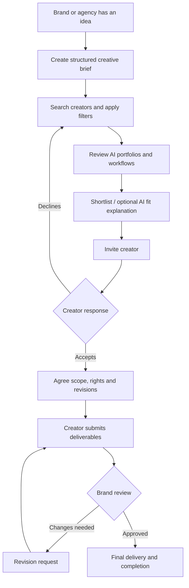
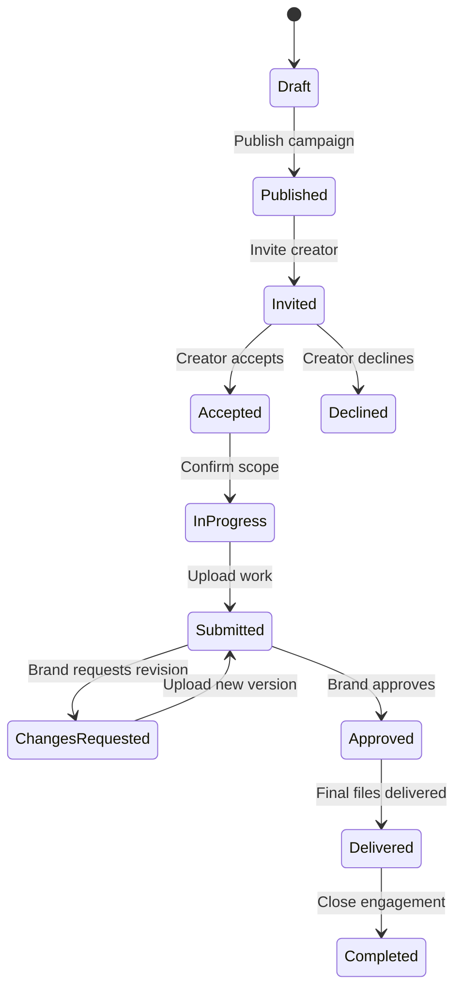
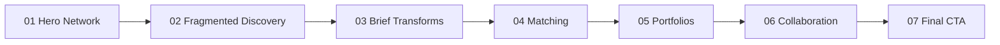
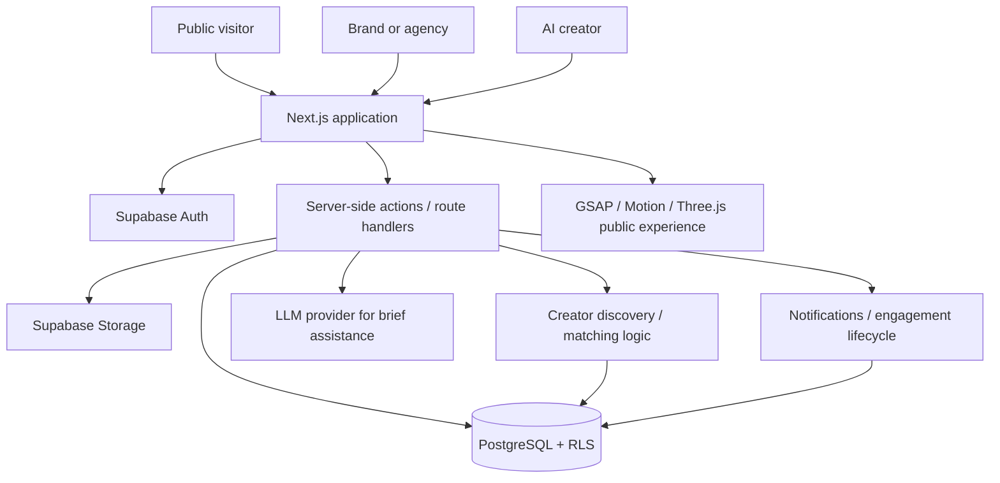

<div align="center">

# AI Content Creator Marketplace

### From a creative brief to the right AI talent, and from first collaboration to final delivery.

**Hackathon Challenge 02 · Kampus.VC · Product & Engineering Documentation**

**Creator portfolios** · **Creative briefs** · **Search & discovery** · **AI assistance** · **Engagements** · **Cinematic 3D web experience**

</div>

> [!IMPORTANT]
> **Project status:** This README documents the intended complete product and its acceptance criteria. The repository's current implementation, integrations, tests, and deployment have **not** been independently verified while preparing this file. Update the [Implementation Status](#implementation-status) section as features are actually built and tested. Do not advertise planned features as shipped features.

---

## Contents

1. [Overview](#overview)
2. [The Problem We Are Solving](#the-problem-we-are-solving)
3. [Our Proposed Solution](#our-proposed-solution)
4. [Who Uses This Platform?](#who-uses-this-platform)
5. [Product Journey at a Glance](#product-journey-at-a-glance)
6. [Complete Feature Guide](#complete-feature-guide)
7. [Public Website & Every Major Page](#public-website--every-major-page)
8. [Cinematic 3D & Scroll Animation System](#cinematic-3d--scroll-animation-system)
9. [Ten Custom Themes](#ten-custom-themes)
10. [Technology & System Architecture](#technology--system-architecture)
11. [Data Model](#data-model)
12. [AI Brief Builder & Matching Intelligence](#ai-brief-builder--matching-intelligence)
13. [Engagement, Revisions & Delivery](#engagement-revisions--delivery)
14. [Commercial Rights & Creator Verification](#commercial-rights--creator-verification)
15. [Security, Accessibility & Performance](#security-accessibility--performance)
16. [Getting Started (Proposed Stack)](#getting-started-proposed-stack)
17. [Environment Variables](#environment-variables)
18. [Testing & Quality Gates](#testing--quality-gates)
19. [Deployment Checklist](#deployment-checklist)
20. [Official Hackathon Evaluation Alignment](#official-hackathon-evaluation-alignment)
21. [Implementation Status](#implementation-status)
22. [Five-Member Team Walkthrough (Tenglish)](#five-member-team-walkthrough-tenglish)
23. [Short Demo Script](#short-demo-script)
24. [Scope & Roadmap](#scope--roadmap)
25. [Troubleshooting & FAQs](#troubleshooting--faqs)

---

## Overview

The **AI Content Creator Marketplace** is a proposed two-sided creative platform for **brands and creative agencies** to discover, evaluate, and collaborate with **AI filmmakers, animators, and generative-content creators**.

Instead of treating every creative professional as a generic freelancer, the platform is designed around **AI-specific production capabilities**: tools and models, production workflows, skills, specialization, content formats, aspect ratios, previous work, and commercial-use considerations.

A brand should be able to:

1. Describe its campaign and prepare a detailed creative brief.
2. Search creators by skills, tools, specialization, content type, and format.
3. Review AI-native portfolios showing *how* each work was produced.
4. Evaluate relevant creator capabilities and available trust signals.
5. Invite a creator and agree on scope and expectations.
6. Track submissions, revision requests, approvals, and final delivery.

A creator should be able to publish a meaningful professional identity, showcase work, and respond to relevant opportunities.

**Product promise:** *Find the right AI creator. Understand their capabilities. Collaborate with confidence.*

### What makes this different?

| A conventional directory | This proposed AI-native marketplace |
|---|---|
| Broad labels such as “designer” or “editor” | AI-specific tools, models, techniques, specializations, and output formats |
| Portfolio thumbnails alone | Work samples plus workflows, aspect ratios, contributions, and rights declarations |
| Manually interpreting vague campaign ideas | Structured creative briefs, with optional AI assistance |
| Generic browsing | Structured filtering and optional explainable fit scores |
| Contact the freelancer elsewhere | A traceable invitation → submission → revision → delivery journey |

> This is a proposed combination of features, **not** a claim that no existing service offers comparable capabilities.

---

## The Problem We Are Solving

Generative AI has created new creative roles: AI filmmakers, prompt-driven animators, generative product-visual artists, AI advertising specialists, and hybrid creative directors. Brands increasingly need these capabilities, but evaluating them is often difficult.

### Five concrete pain points

| Problem | What happens in practice | Why it matters |
|---|---|---|
| **Fragmented discovery** | Creators show work across social platforms, personal sites, portfolios, and communities. | Brands spend time manually building shortlists. |
| **Unclear production capability** | A finished image may not show the tools, editing, role, or repeatable workflow behind it. | A portfolio can look suitable without proving the creator can deliver the required format. |
| **Incomplete briefs** | “Make an AI video for our launch” leaves style, duration, ratio, budget, and licensing unclear. | Rework and mismatched expectations become more likely. |
| **Weak commercial-use clarity** | Ownership, third-party assets, tools' terms, usage territories, and rights are not always documented. | A brand cannot safely assume every generated asset can be reused in paid advertising. |
| **Fragmented delivery workflow** | Requests, feedback, versions, and approved files are exchanged in separate channels. | It is harder to know what was agreed, revised, and finally accepted. |

### Example: a real creative requirement

A fashion brand needs a **30-second vertical (9:16) luxury-style AI advertisement** for Instagram, with **two revision rounds** and **commercial paid-ad use**. It wants a creator who can show relevant past work and explain which tools, production stages, and post-processing methods they actually used.

The challenge is not merely finding an “AI creator.” It is finding someone who can satisfy **this specific technical, creative, and commercial brief**.

---

## Our Proposed Solution

Build a central, understandable marketplace that joins **creator discovery**, **AI-native portfolios**, **structured briefs**, and **project collaboration**.



### Guiding principles

- **Functional before decorative:** a complete search and portfolio journey matters more than a flashy landing page.
- **Clarity before novelty:** users should understand every field, status, and next action.
- **AI assists, humans decide:** AI may propose or explain; users confirm briefs and collaboration terms.
- **No pretend verification:** a self-declared skill is not the same as independently verified evidence.
- **No invented business metrics:** sample records and demonstration scenarios are clearly labelled.
- **Accessible motion:** impressive visuals must never block the application or reduce usability.

---

## Who Uses This Platform?

| Role | What they do | Main destination |
|---|---|---|
| **Visitor** | Explore the website, creators, and public portfolios. | Public pages |
| **Brand** | Create briefs, search, invite, review, and approve work. | Brand dashboard |
| **Creative agency** | Manage creative campaigns, potentially on behalf of clients. | Brand/agency workspace |
| **AI creator** | Publish capabilities and AI work, respond to invitations, deliver projects. | Creator dashboard |
| **Moderator / admin** | Review verification evidence, reports, and safety issues. | Restricted internal tools |

**Role boundary:** a visitor may browse public portfolios without registration. Identity is required to own a creator profile, publish a brand brief, send invitations, or exchange private project files.

---

## Product Journey at a Glance

### Brand journey

**Visit → Browse → Sign in → Write brief → Discover → Evaluate → Invite → Review → Approve → Deliver**

A brand can begin with creator discovery, or begin by publishing a brief. These two entry points should converge into the same campaign workspace.

### Creator journey

**Register → Complete profile → Add tools and workflows → Upload portfolio → Publish → Receive invitation → Accept → Submit versions → Deliver**

### Collaboration lifecycle



Each status must be tied to a **real server-side action and persisted record**, not just a change in frontend text.

---

## Complete Feature Guide

| Feature | Experience | Critical behavior |
|---|---|---|
| **Creator profiles** | Headline, bio, location, skills, tools, formats, rates, availability. | Data survives refresh; only the owner can edit. |
| **AI-native portfolios** | Images, videos, animations, project details, workflow steps, contribution and rights declaration. | Real uploads and published/private visibility. |
| **Creator discovery** | Search, multi-filter, sort, result count, clear filters. | Correct server-backed results and useful empty states. |
| **Structured campaign briefs** | Audience, style, type, format, aspect ratio, deliverables, budget, deadline, commercial use. | Validation, drafts, editing, publication. |
| **AI-assisted brief builder** | Turn rough-language ideas into editable structured fields. | Actual model call, schema validation, uncertainty markers, manual fallback. |
| **Optional matching intelligence** | Campaign compatibility score and factor breakdown. | Calculated from real profile data, never random numbers. |
| **Shortlisting** | Save creators for a specific campaign. | Persistent per-user/campaign state. |
| **Invitations** | Brand sends project offer; creator accepts or declines. | Permissions, duplicates, transactional updates. |
| **Engagement workspace** | Work scope, deliverable list, milestones, activity and status. | Only authorized participants can access. |
| **Revisions** | Brand requests changes; creator submits new version. | Version history and clear revision count. |
| **Final delivery** | Approved files, download, status and timestamps. | Secure access and completion only after appropriate approvals. |
| **Creator trust signals** | Self-declared, evidence submitted, under review, verified. | Never automatically grant a “verified” badge. |
| **Notifications** | Invitations, submissions, revisions, approval messages. | Actual stored notifications and read states. |
| **Theme selector** | Ten art-directed visual themes. | Applies across public pages, app UI, and 3D scene where relevant. |
| **Accessibility** | Keyboard operation, focus, reduced-motion and mobile layouts. | Core journey remains usable without cinematic animation. |

### Brief fields (minimum and advanced)

**Official challenge focus:** campaign requirements, content type, creative style, format/aspect ratio, and commercial-use requirements.

**Additional useful fields:** target audience, platform, video duration, resolution, deliverable quantity, budget, currency, deadline, preferred tools, source assets, territory, usage duration, exclusivity, revision rounds, and reference links.

> Commercial-use information is a **requirement and agreement record**; the platform should not promise that an AI tool's output is automatically legally cleared for every use.

---

## Public Website & Every Major Page

### Public information architecture

| Route | User purpose | Main interactions |
|---|---|---|
| `/` | Understand the product and enter a primary flow. | Discover, start a brief, become a creator, theme picker. |
| `/how-it-works` | Understand buyer and creator journeys. | Role-specific tabs and links to relevant steps. |
| `/discover` | Find suitable AI talent. | Search, filters, sorting, profile navigation, clear-all. |
| `/creators/[slug]` | Evaluate a creator. | Portfolio, tools, workflows, invitation CTA. |
| `/projects/[slug]` | Understand a portfolio piece. | Media, output specifications, rights declarations, workflow. |
| `/for-brands` | Understand benefits to buyers. | Create brief / discover CTA. |
| `/for-creators` | Understand benefits to creators. | Creator registration CTA. |
| `/about` | Understand the mission and scope. | Product background and contact. |
| `/faq` | Get answers. | Accessible accordion and relevant links. |
| `/contact` | Request support. | Validated form and clear submission state. |
| `/privacy`, `/terms` | Review the platform's legal documents. | Readable, accurate, reviewable content. |

### Authenticated routes (suggested; align to actual repo)

```text
/app/
  brand/
    dashboard
    campaigns
    campaigns/new
    campaigns/[id]
    campaigns/[id]/matches
    invitations
    engagements
  creator/
    dashboard
    profile
    skills
    portfolio
    portfolio/new
    invitations
    engagements
    verification
  engagements/[id]
  notifications
  settings
```

The final route names may change, but every major user journey must have a consistent destination and working navigation.

### Public homepage narrative

| Section | Visual language | What the visitor learns | CTA / interaction |
|---|---|---|---|
| **01. Hero** | Giant typographic statement plus a custom 3D network. | The platform joins brands and AI creators. | Explore Creators / Start a Brief. |
| **02. The problem** | Editorial, separated creator cards. | Discovery is scattered; capability is hard to assess. | Learn how it works. |
| **03. Structured briefs** | Text transforms into visual requirement fields. | Precise inputs improve sourcing. | Open real brief builder. |
| **04. Discovery** | An interactive filter/storytelling visualization. | Find creators by actual production capability. | Search creators. |
| **05. Matching** | A campaign meets relevant creator representations. | Optional compatibility rankings are explainable. | View relevant portfolios. |
| **06. AI portfolios** | Large media-led horizontal gallery. | Past work includes tools, format, and workflow context. | Open creator profile. |
| **07. Engagement** | Visual project progression. | Collaboration continues through revisions and delivery. | Get started. |
| **08. FAQs / CTA** | Clear type, spare layout, sharp interactions. | Questions are answered and next action is obvious. | Join as creator / find talent. |

No fictional customer logos, fabricated creator counts, fake success percentages, or pretend platform milestones.

---

## Cinematic 3D & Scroll Animation System

The public experience is planned as a **coherent, scroll-driven product story**, not ten unrelated effects. The 3D animation should illustrate real product ideas: creator discovery, brief structuring, matching, and collaboration.

### Technology responsibilities

| Technology | What it owns | What it should NOT own |
|---|---|---|
| **Three.js + React Three Fiber** | 3D objects, materials, lighting, rendering and camera. | Forms, authorization, database logic. |
| **Drei** | Practical scene helpers and optimized 3D utilities. | Replacing design quality with generic effects. |
| **GSAP + ScrollTrigger** | Scroll progress, pinned scenes, camera/object timelines. | Independent state transitions already owned by another animation library. |
| **Motion for React** | Modal, menu, card, button and app-level microinteractions. | Scroll-driven camera timelines already controlled by GSAP. |
| **Lenis** | Optional smooth desktop scrolling, integrated carefully with ScrollTrigger. | Scroll-jacking, keyboard interference, or forced motion. |
| **CSS** | Typography, responsive layouts, subtle hover and color transitions. | Expensive per-frame browser layout changes. |

### Seven-scene homepage storyboard



#### Scene 01 — The connection universe (roughly 0–15% of narrative progress)

- A large campaign artifact floats in a carefully composed 3D scene, accompanied by a **small, intentional** set of creator artifacts.
- Creator elements feature subtle production-related identifiers; they are not generic random glowing particles.
- The camera adds small pointer-driven parallax without interfering with reading or controls.
- A bold editorial headline reveals in deliberate masks; primary CTAs appear early and remain clickable.
- Scrolling gently moves the camera closer to the campaign and introduces the fragmented ecosystem.

#### Scene 02 — Discovery is fragmented (15–30%)

- Creator cards and portfolio fragments move apart in depth, showing how information is scattered.
- Connection paths break up; the main message emerges: **“The talent exists. Discovery is fragmented.”**
- Four problems appear in a paced editorial sequence: scattered work, unclear tools/workflows, vague briefs, separate collaboration channels.
- On mobile, transform the pinned scene into a straightforward vertical narrative.

#### Scene 03 — From idea to structured brief (30–45%)

- A rough campaign sentence appears as an editorial composition, not an auto-submitted form.
- Scrolling reorganizes the sentence into fields such as **content type, style, aspect ratio, deadline, and commercial-use need**.
- Unknown details show **“Needs confirmation”**, not made-up AI conclusions.
- CTA routes to the **real campaign form**. Scrolling itself must not trigger billable AI API calls.

#### Scene 04 — Search, evaluate, match (45–65%)

- The campaign artifact occupies the center; qualified creators move toward it based on an illustrative compatibility story.
- Some creator cards move away when they lack a necessary capability such as 9:16 video production.
- Relevant creators move forward into legible 2D cards with clear specialization and portfolio links.
- A score breakdown can appear **only** when backed by a defined algorithm or clearly marked as illustrative.
- Camera motion should be slow enough to preserve text legibility and visual continuity.

#### Scene 05 — AI portfolio gallery (65–80%)

- Vertical scroll drives a horizontal gallery of large, media-led creator work.
- Hover reveals creator name, tools, and project metadata without blocking playback or navigation.
- Focus and touch interactions must open the same project detail as mouse hover/click.
- Gallery data is sourced from **published portfolio records**; use clearly labelled sample records if necessary.

#### Scene 06 — Collaboration (80–90%)

- Campaign and creator artifacts connect to form a clean shared project visual.
- A small project timeline appears: **invitation → accepted → submitted → revision → approved → delivered**.
- The viewer sees that the platform covers creative work, not only talent discovery.

#### Scene 07 — Final call to action (90–100%)

- Scene elements reduce into a quiet, recognizable composition instead of exploding into more effects.
- The final headline, two working CTAs, FAQs, and footer remain readable and accessible.
- Motion is subordinate to the user's decision to navigate.

### Animation implementation rules

1. Prefer **one persistent, lazily loaded WebGL canvas** for the landing-page narrative, with semantic HTML content rendered above or alongside it.
2. Drive camera and object transforms from **normalized scroll progress**; use React refs and GSAP contexts to avoid rerendering the whole React tree on every frame.
3. Avoid two animation libraries controlling the same property simultaneously.
4. Use mostly transform/opacity animations; avoid expensive layout animation on scroll.
5. Cap device pixel ratio; keep polygon/particle counts low; compress and lazy-load textures.
6. Test the experience on a standard laptop, not only a fast development desktop.
7. Provide a **static/low-motion fallback** for unsupported WebGL, reduced-motion, and constrained mobile devices.
8. Use **WebGL as the reliable default**; WebGPU may be a feature-detected enhancement, never a requirement for page functionality.
9. Keep the public site's content readable without animation and ensure canvas overlays do not swallow clicks.
10. Remove event listeners, ScrollTriggers, animation loops, and scene resources when no longer needed.

### Microinteraction details

| Interaction | Behavior | Accessibility / fallback |
|---|---|---|
| Navigation hover | 150–200 ms underline expansion, no bounce. | Focus underline for keyboard. |
| CTA hover | Crisp color inversion or accent line. | Same action on tap and keyboard. |
| Creator image | Brief inner-image zoom; outer card stays steady. | Tap opens details; no hover-only content. |
| FAQ open/close | 200 ms height/opacity transition. | ARIA-expanded and keyboard operation. |
| Campaign wizard | Clear step feedback, short transitions. | Never trap focus or hide validation errors. |
| Matching progress | Real loading state, no fabricated multi-step “AI processing” theater. | Announce result/error. |
| Upload | Visible progress, success, retry and size/type failures. | Text feedback independent of motion. |
| Theme switch | Brief semantic token transition; update 3D colors. | No white flash and sufficient contrast. |

---

## Ten Custom Themes

The platform supports a **proposed ten-theme visual system**. These are not supposed to be ten copy-pasted color palettes. Each theme keeps the same product flows while adjusting typography, component treatment, surfaces, media framing, and 3D materials.

| Theme | Background | Accent | Art direction | 3D character |
|---|---|---|---|---|
| **01 Obsidian Editorial** | `#11110F` | `#D95736` | Dark luxury editorial, warm type and negative space. | Charcoal metal, warm highlights. |
| **02 Paper & Ink** | `#F4F0E7` | `#B7432B` | Swiss print grid, large type, crisp lines. | Matte ceramic, gallery lighting. |
| **03 Carbon Acid** | `#131715` | `#D4ED65` | Experimental technical layout, mono metadata. | Kinetic geometry, acid-lime traces. |
| **04 Midnight Cobalt** | `#09152B` | `#8BA8FF` | Refined deep-blue technology studio. | Sapphire-like surfaces, controlled orbit. |
| **05 Terracotta Atelier** | `#EBDCCE` | `#B85C3C` | Warm creative art-book composition. | Clay and copper materials. |
| **06 Arctic Signal** | `#E8F1F0` | `#008C83` | Airy technical minimalism. | Soft diffuse lighting, precise depth. |
| **07 Plum Archive** | `#21151F` | `#E4A0B9` | Fashion editorial and oversized photography. | Plum/rose sculptural lighting. |
| **08 Industrial Mono** | `#E6E5E0` | `#EF5836` | Sharp brutalist borders, functional grids. | Architectural blocks, crisp motion. |
| **09 Analog Film** | `#29231C` | `#DBAB57` | Warm cinematic production-house language. | Bronze highlights, slow camera drift. |
| **10 Deep Teal Gallery** | `#092D30` | `#F4AA78` | Art gallery layout, deep teal and bronze-peach. | Refined gallery sculptures. |

### Theme engineering requirements

- Shared semantic CSS tokens (`background`, `foreground`, `surface`, `border`, `accent`, `focus`, `danger`, `success`, `chart-1`, etc.).
- Centralized theme registry; **do not duplicate the application ten times**.
- Theme selector in public navigation and authenticated settings.
- Persist guest preference locally and authenticated preference where supported.
- The initial page should show the chosen theme without hydration flash.
- All ten themes must cover dialogs, forms, dropdowns, tables, charts, empty states, and 3D appearance.
- Each theme must pass readability and accessibility checks; accent colors are not necessarily suitable for long body text.
- Apply visual customization **after** the central interaction, typography, and core product flows are reliable.

---

## Technology & System Architecture

### Proposed stack

| Concern | Technology |
|---|---|
| Frontend and server application | Next.js App Router, React, strict TypeScript |
| Styling and design tokens | Tailwind CSS + authored CSS custom properties |
| Accessible UI primitives | Radix / selectively customized shadcn/ui |
| Scroll motion | GSAP + ScrollTrigger |
| UI motion | Motion for React |
| Smooth scroll | Lenis where beneficial |
| 3D | Three.js, React Three Fiber, Drei |
| Authentication | Supabase Auth |
| Relational data | Supabase PostgreSQL |
| Uploads | Supabase Storage |
| Validation | Zod + React Hook Form |
| AI | One selected LLM API used server-side |
| Hosting | Vercel |
| Unit/integration tests | Vitest |
| Browser end-to-end tests | Playwright |
| Source control | Git + GitHub |

The application should have **one coherent backend**; a separate Express or Python service is not needed for the initial scope unless a specific requirement justifies it.



### Suggested source organization

```text
src/
  app/
    (marketing)/
    (auth)/
    app/
    api/
  components/
    marketing/
    discovery/
    creator/
    campaign/
    engagement/
    ui/
  3d/
    scene/
    camera/
    nodes/
    scroll/
  lib/
    ai/
    matching/
    permissions/
    supabase/
    validations/
  config/
    site.ts
    themes.ts
  types/
supabase/
  migrations/
  seed/
tests/
  unit/
  e2e/
```

This folder tree is **illustrative**. Match the actual existing repository instead of pretending the folders already exist.

---

## Data Model

| Table / entity | Purpose | Notable fields |
|---|---|---|
| `profiles` | Common account identity and role. | `user_id`, `role`, `display_name` |
| `organizations` | Brands and agencies. | `owner_id`, `name`, `type` |
| `creator_profiles` | Public creator identity and commercial preferences. | `slug`, `bio`, `specialization`, `rates`, `availability`, `status` |
| `creator_skills` / `creator_tools` | Searchable capabilities and tool claims. | `creator_id`, `skill/tool_id`, `experience`, `verification_state` |
| `portfolio_projects` | Project case studies and workflows. | `creator_id`, `title`, `tools`, `workflow`, `rights_declaration` |
| `portfolio_media` | Image/video assets and file metadata. | `project_id`, `path`, `mime_type`, `visibility` |
| `campaigns` | Brand briefs and lifecycle. | `organization_id`, `title`, `status`, `deadline`, `budget` |
| `campaign_requirements` | Structured creative and output criteria. | `content_type`, `style`, `aspect_ratio`, `deliverables` |
| `campaign_rights` | Requested commercial-use scope. | `channels`, `territory`, `duration`, `exclusivity` |
| `matches` | Optional saved compatibility scores. | `campaign_id`, `creator_id`, `score`, `factor_scores`, `version` |
| `invitations` | Offers and responses. | `campaign_id`, `creator_id`, `status`, `offer` |
| `engagements` | Accepted work arrangement. | `campaign_id`, `creator_id`, `status`, `agreed_terms` |
| `deliverables` | Work items due. | `engagement_id`, `title`, `due_date`, `status` |
| `submissions` | Submitted work versions. | `deliverable_id`, `version`, `storage_path` |
| `revision_requests` | Review comments and requested changes. | `submission_id`, `feedback`, `status` |
| `approvals` | Approval trail. | `submission_id`, `approver_id`, `approved_at` |
| `verification_requests` | Evidence and review status. | `creator_id`, `evidence`, `review_state` |
| `notifications` | Inbox changes and activity. | `recipient_id`, `type`, `read_at` |
| `audit_events` | Sensitive system actions. | `actor_id`, `operation`, `entity`, `timestamp` |

### Core database behavior

- Public users see **only published, public profiles and media**.
- Creators can edit **only their own** profiles, portfolios, and verification submissions.
- Buyers manage **only campaigns owned by their organization**.
- Invitation, project, file, and approval permissions depend on actual participation and role.
- Every engagement state transition is validated server-side; duplicate clicks must not create duplicate engagements.
- Stored AI explanations should include a score/model version if they depend on calculated features.
- Use indexes on creator filters, published status, campaign ownership, and relationship IDs.
- Use migration files, constraints, and Row Level Security. Do not rely on frontend visibility as authorization.

---

## AI Brief Builder & Matching Intelligence

### AI-assisted brief creation (bonus)

**Input:** “Need a luxury 30-second perfume ad for Instagram.”

**Expected output:** a draft structured brief with *known*, *suggested*, and *missing* values separated.

| Field | Result | Confidence handling |
|---|---|---|
| Industry | Beauty / perfume | Extracted from input. |
| Content type | Video ad | Extracted from input. |
| Style | Luxury | Extracted from input. |
| Duration | 30 seconds | Extracted from input. |
| Platform | Instagram | Extracted from input. |
| Aspect ratio | 9:16 | Suggested, **must be confirmed**. |
| Budget | Not supplied | Missing. |
| Commercial license | Not supplied | Missing, **must not be invented**. |
| Revision rounds | Not supplied | Missing. |

Flow: client input → server-side LLM → validated JSON → editable form → human confirmation → persisted campaign.

**Failure handling:** if the AI API fails, the standard manual form remains available.

### Optional explainable matching

A starter compatibility model can combine different measurable factors:

```text
Compatibility (%) =
    30% × style/specialization match
  + 20% × required AI tools match
  + 20% × content type / format compatibility
  + 15% × industry relevance
  + 15% × budget and availability fit
```

These weights are **a proposed implementation choice**, not supplied by the organizers and not a statistical success probability.

**Hard requirements first:** a creator who cannot supply a mandatory output format may be excluded rather than rewarded by unrelated high scores. Tool proficiency and portfolio evidence should be represented honestly. Missing fields must not automatically count as matches.

**The language model does not invent the percentage.** A deterministic engine computes compatible factors, then AI can optionally explain the result in natural language. A readable non-AI explanation should remain available if the model is offline.

---

## Engagement, Revisions & Delivery

Discovery alone is not enough: the official challenge statement calls for **engagement from discovery through delivery**.

### Typical engagement objects

1. **Invitation:** buyer, creator, selected campaign, optional budget and message.
2. **Agreed terms:** deliverables, deadline, rights requested/granted, revision allowance, dependencies.
3. **Deliverables:** each required asset and its due date.
4. **Submission:** a creator uploads a version, file metadata, and comments.
5. **Review:** buyer approves or requests explicit changes.
6. **Revision:** creator uploads a new version linked to the prior submission.
7. **Final delivery:** approved assets become available to authorized users and status is recorded.

### Rules that prevent misleading behavior

- A **pending invitation** is not the same as a confirmed engagement.
- An **accepted invitation** does not silently imply that all legal/licensing terms were agreed.
- An **uploaded draft** is not automatically an approved deliverable.
- A **revision request** should include actionable feedback, not only a status change.
- A project is not **completed** unless the defined final-delivery conditions have been satisfied.
- Payment, escrow, or automatic rights clearance must **not** be claimed unless truly implemented.

---

## Commercial Rights & Creator Verification

### Commercial-use fields to capture

| Category | Questions to clarify |
|---|---|
| Purpose | Organic social, paid ads, broadcast, website, packaging? |
| Territory | Local, national, worldwide? |
| Duration | One campaign, 12 months, perpetual? |
| Exclusivity | Exclusive to this client or non-exclusive? |
| Rights arrangement | Limited license or other expressly negotiated arrangement? |
| Third-party materials | Models, music, stock, likenesses, trademarks, client-supplied assets? |
| Tool restrictions | Do relevant AI services permit the intended commercial use under applicable terms? |
| Portfolio display | May the creator publish the resulting work publicly? |

These fields **record requirements and agreements**. They are not a substitute for legal review or a guarantee of ownership.

### Trust/verification states (bonus)

- **Self-declared:** creator entered the claimed tool or capability.
- **Evidence submitted:** supporting material was provided.
- **Under review:** an authorized reviewer is examining the submission.
- **Verified:** explicitly defined checks were successfully completed.
- **Rejected:** evidence did not meet the stated standard.

**Verification of tool familiarity is not verification of copyrights, licenses, or all creative claims.** Private evidence must not be publicly exposed.

---

## Security, Accessibility & Performance

### Security and reliability

- Server-side authentication and role/ownership checks.
- PostgreSQL Row Level Security policies for creator, brand, invitation, and engagement resources.
- Signed/private access to confidential project assets and verification evidence.
- File MIME/size restrictions; authorized upload paths; cleanup on deletion where appropriate.
- Server-only LLM credentials and secrets; never expose privileged keys in client bundles.
- Validation for user forms and AI JSON; rate limiting for public forms and AI endpoints.
- Transactional/idempotent acceptance, submission, and approval actions.
- Explicit success, error, loading, validation, offline, and empty states.

### Accessibility

- Responsive desktop, tablet, and mobile layouts.
- Semantic headings and readable line lengths.
- Keyboard-accessible menus, filters, dialogs, and forms.
- Visible focus states and labeled form controls.
- Motion reduction that genuinely removes nonessential camera movement and scroll choreography.
- Touch equivalents for hover-only portfolio interactions.
- Appropriate text contrast in **all ten themes**.

### Performance targets and practices

Measure actual device performance instead of making unverified 60 FPS claims. Prioritize optimized media, lazy-loading, a lightweight authenticated dashboard, and fast search. Keep expensive rendering isolated to the public experience.

---

## Getting Started (Proposed Stack)

> [!NOTE]
> These are **proposed standard commands for a Next.js implementation**. Check the actual `package.json`, migration paths, and environment requirements in the repository before running them. They are not proof that the application is already configured.

### Prerequisites

- Current compatible Node.js LTS and npm.
- A Supabase project with Auth, PostgreSQL, and Storage.
- An API key for the chosen LLM provider (only if AI assistance is enabled).
- A GitHub repository and optional Vercel account.

### Development setup

```bash
# Clone your real repository URL (replace the placeholder).
git clone <YOUR_GITHUB_REPOSITORY_URL>
cd <YOUR_REPOSITORY_DIRECTORY>

# Install project dependencies.
npm install

# Create local environment settings based on documented configuration.
cp .env.example .env.local

# Apply actual project database migrations and seed data as documented.
# Then launch the development server.
npm run dev
```

Open `http://localhost:3000` if the development server uses the standard Next.js port.

### Suggested project scripts

```bash
npm run dev         # Local development
npm run build       # Production build check
npm run lint        # Linting (if configured)
npm run test        # Unit/integration tests (if configured)
npm run test:e2e    # Browser tests (if configured)
```

Do not describe optional scripts as available until they exist in `package.json`.

---

## Environment Variables

Illustrative configuration for a Next.js + Supabase + selected LLM integration:

```dotenv
# Public browser-safe Supabase connection
NEXT_PUBLIC_SUPABASE_URL=your_supabase_project_url
NEXT_PUBLIC_SUPABASE_ANON_KEY=your_public_anon_key

# Branding can be changed without renaming components
NEXT_PUBLIC_SITE_NAME=AI Content Creator Marketplace

# Server-side LLM credentials (choose and implement one actual provider)
AI_PROVIDER_API_KEY=your_server_only_key

# Optional: only if your server implementation actually needs privileged operations
# SUPABASE_SERVICE_ROLE_KEY=server_only_never_expose
```

Never commit real `.env.local` values. Confirm the exact variable names expected by the actual code. Keep all privileged credentials on the server.

---

## Testing & Quality Gates

### Recommended automated tests

| Test type | What to verify |
|---|---|
| **Unit** | Brief validation, matching factors, budgets, filter predicates, status transitions. |
| **Integration** | Portfolio CRUD, campaign persistence, invitation acceptance, file authorization. |
| **E2E** | Two-account creator → brand → invitation → revision → delivery flow. |
| **Accessibility** | Forms, navigation, dialogs, focus, contrast and reduced-motion. |
| **Visual** | Home, discover, profile, dashboard across themes and device sizes. |
| **Production smoke** | Sign in, search, upload, AI fallback, invitation and refresh on deployed URL. |

### Manual end-to-end demonstration checklist

- [ ] Create creator account and complete profile.
- [ ] Upload and publish actual project media with tools, workflow, and output metadata.
- [ ] View the creator from an unauthenticated browser session.
- [ ] Register as a brand and create a complete commercial-use brief.
- [ ] Test creator search by specialization, tool, content type, and aspect ratio.
- [ ] Test empty search results and clear filters.
- [ ] Invite the selected creator and ensure a duplicate invitation is prevented.
- [ ] Accept the invitation from the creator account.
- [ ] Verify the engagement appears for both authorized users.
- [ ] Upload a deliverable, request changes, upload a new version, and approve it.
- [ ] Confirm secure final-delivery access.
- [ ] Refresh pages and verify persistence and correct statuses.
- [ ] Try accessing another user's private data and confirm rejection.
- [ ] Verify themes, responsive layouts, keyboard access, and reduced-motion mode.
- [ ] Verify production build and public deployment from another device.

---

## Deployment Checklist

1. Commit current source, dependency lockfile, migrations, and documentation.
2. Configure a production Supabase project with correct migrations and Row Level Security.
3. Configure storage buckets, restrictions, policies, and private asset handling.
4. Set Vercel environment variables for actual public and server-side keys.
5. Configure authentication redirect URLs and verified production domain.
6. Deploy a production build and check server/API errors.
7. Test using **two separate accounts** and an incognito session.
8. Verify media access, AI fallback, all major forms, theme persistence, and final delivery.
9. Review the deployed application on mobile and a standard laptop.
10. Add verified deployment links and screenshots to this README **only after confirming them**.

**Live URL:** _Add after successful deployment and verification._  
**Demonstration video:** _Add after recording a working flow._  
**Screenshots:** _Add after capturing the actual implementation._

---

## Official Hackathon Evaluation Alignment

The supplied full challenge brief allocates **100 points** as follows:

| Evaluation criterion | Weight | Evidence the team should demonstrate |
|---|---:|---|
| **Creator Profiles & AI Portfolios** | **30** | Detailed creator profile, actual media, tools/models, specialization, workflow. |
| **Brief Definition** | **20** | Structured creative brief including content type, style, format/aspect ratio, commercial-use requirements. |
| **Discovery & Filtering** | **25** | Correct filtering, sensible results and empty-search handling. |
| **User Experience** | **15** | Easy brand and creator flows, understandable portfolio browsing. |
| **Presentation & Demo** | **10** | Clear short demonstration of working functionality. |
| **Total** | **100** | |

**Bonus:** creator verification signals and AI-assisted brief creation may contribute roughly **5–10 points combined**, within their relevant criteria as described in the supplied brief.

### Priority implication

**75/100 base points** relate directly to creator portfolios, brief definition, and discovery. A beautiful 3D hero and ten themes can support UX, but **cannot compensate for broken portfolio uploads or inaccurate search**.

The challenge's stated deliverables are a **working prototype**, a **short profile/brief data-model note**, and a **short demo or slides**. This project's additional goal is a live-deployed, functional end-to-end implementation.

---

## Implementation Status

> [!WARNING]
> This is a **truthful checklist**, not a claim of completed work. Check an item only after it is implemented and verified in the running project.

- [ ] Public pages and responsive navigation.
- [ ] Creator registration, profile editor, publishing and portfolio upload.
- [ ] Complete structured creative briefs and commercial-use fields.
- [ ] Database-backed search, filters, sorting and empty states.
- [ ] Invitations, acceptance and role-based access.
- [ ] Deliverables, revision versioning, approval and final delivery.
- [ ] AI-assisted brief parser with validation and fallback.
- [ ] Optional explainable matching and shortlist.
- [ ] Evidence-backed creator verification states.
- [ ] Seven-scene cinematic marketing scroll experience.
- [ ] Ten complete and accessible custom themes.
- [ ] Unit, integration, accessibility and E2E tests passing.
- [ ] Public production deployment verified.

When work is complete, replace this checklist with actual feature statuses, links to screenshots/tests, and known limitations.

---

## Five-Member Team Walkthrough (Tenglish)

Ee section project ni first time chuse teammate ki kuda easy ga ardham ayyelaga rasam.

### Asalu problem enti?

**Brands ki correct AI creator ni vetakadam, evaluate cheyyadam kastam.** Oka creator AI videos chesthada, Midjourney/Runway/Kling use chesthada, 9:16 output deliver cheyyagalada, commercial ads kosam required permissions clear ga unnaya ani manual ga check cheyyalsi vastundi.

### Mana solution enti?

**One marketplace lo creator skill, AI tool, portfolio, workflow, commercial-use information anni clear ga untayi.** Brand brief create chesthundi, creators ni filters tho shortlist chesthundi, creator ni invite chesthundi, versions review chesthundi, final work receive chesthundi.

### AI ekkada use avutundi?

**AI Brief Builder** brand rough idea ni structured fields ga suggest chesthundi. Optional **Matching Explanation** creator fit reasons ni easy language lo chepthundi. Kani score random ga AI guess cheyyadu; data-based algorithm calculate chesthundi.

### Website lo 3D enduku?

**3D and scroll animations product story ni explain cheyyadaniki.** Homepage lo scattered creator nodes → structured brief → matching → collaboration visual ga chupistham. Dashboard lo heavy animations vadakunda fast ga work chese UI maintain chestham.

### Full-stack ante enti?

- **Frontend:** user chuse pages, forms, portfolios, animations.
- **Backend:** campaign saving, search logic, invitations, permissions, AI request handling.
- **Database:** users, profiles, portfolios, campaigns, engagements, revisions records store chesthundi.
- **Storage:** uploaded images/videos safe ga save chesthundi.
- **Auth:** evaru login ayyaru, evariki ee data access undali anedi control chesthundi.
- **Deployment:** website vere laptop or phone nunchi kuda accessible ga untundi.

### Suggested speaking ownership

| Member | Main explanation |
|---|---|
| 1 | Problem, official challenge and public website story. |
| 2 | Creator profiles, AI portfolios and evidence/verification. |
| 3 | Brand brief, commercial-use fields, search/filter demo. |
| 4 | AI assistance, optional compatibility scoring and its limitations. |
| 5 | Invitations, revision-to-delivery, backend architecture and deployment. |

**Everyone** should still be able to explain the full product journey in one minute.

---

## Short Demo Script

A **4–5 minute** demo should focus on the official scoring criteria, not on touring every page.

| Approx. time | Show | Message |
|---|---|---|
| 0:00–0:30 | Problem and product positioning | Finding AI talent is not the same as evaluating AI production capability. |
| 0:30–1:25 | Creator profile and portfolio | Tools, workflows, formats, and past work are visible. |
| 1:25–2:15 | Brand brief builder | Creative and commercial requirements become clear and structured. |
| 2:15–3:05 | Creator discovery and filters | Search reacts correctly, including a no-results case. |
| 3:05–4:10 | Invitation and project workflow | Accept → submit → revise → approve → deliver. |
| 4:10–4:40 | Architecture, live deployment, closing | Actual data, permissions, tests and end-to-end behavior. |

If AI assistance is working reliably, show it briefly during brief creation. If the model is temporarily unavailable, use the manual form rather than pretending an API response occurred.

---

## Scope & Roadmap

### P0 — Score-critical foundation

Creator profiles, AI portfolio uploads and metadata, brief definition including commercial-use requirements, working discovery/search/filters, authentication, authorization and persistent database.

### P1 — End-to-end collaboration

Invitation states, accepted engagement, project submissions, revision history, review, approval and secure delivery.

### P2 — Intelligent enhancements and trust

AI-assisted briefs, meaningful verification workflow, optional transparent matching, notifications and better shortlisting.

### P3 — Artistic polish

Cinematic scroll-driven Three.js storytelling, theme-specific 3D materials, ten complete themes, and high-quality editorial microinteractions.

**No fake-feature rule:** remove an unfinished public control rather than shipping an inert button that looks functional.

---

## Troubleshooting & FAQs

<details>
<summary><strong>Why are there no creators in search results?</strong></summary>

Check whether profiles are published, whether data exists in the database, and whether all selected filters are too restrictive. The UI should offer Clear Filters without showing irrelevant people as exact matches.

</details>

<details>
<summary><strong>Why does an uploaded image fail or not display?</strong></summary>

Check MIME/size limits, the storage bucket's policy, ownership paths, public/published visibility, and browser network errors. Ensure the database record points to an authorized media path.

</details>

<details>
<summary><strong>What if the AI API is unavailable?</strong></summary>

The manual creative brief editor must continue working. No fake AI response or random matching score should be shown.

</details>

<details>
<summary><strong>Why can't another user open an engagement?</strong></summary>

Only the brand/agency participants and assigned creator should access private engagement data and files. Test these restrictions with different accounts.

</details>

<details>
<summary><strong>Why are the 3D animations simplified on my phone?</strong></summary>

The visual system should intentionally reduce GPU load on smaller or weaker devices. Product functionality is more important than rendering the same heavy scene everywhere.

</details>

<details>
<summary><strong>Are creator skill badges legally or technically verified?</strong></summary>

Only badges backed by a completed review process should say Verified. Otherwise show Self-declared, Evidence submitted, or Under review accurately.

</details>

<details>
<summary><strong>Does the marketplace automatically guarantee commercial-use rights?</strong></summary>

No. The product records requirements and agreements, but rights also depend on actual assets, tool/provider terms, third parties, applicable law, and the negotiated arrangement.

</details>

---

<div align="center">

### The goal is not another freelancer directory.

**The goal is to make AI creative capability discoverable, comparable, and actionable, from the first brief to the final approved deliverable.**

*Built for Hackathon Challenge 02. Designed for a real end-to-end user experience.*

</div>
