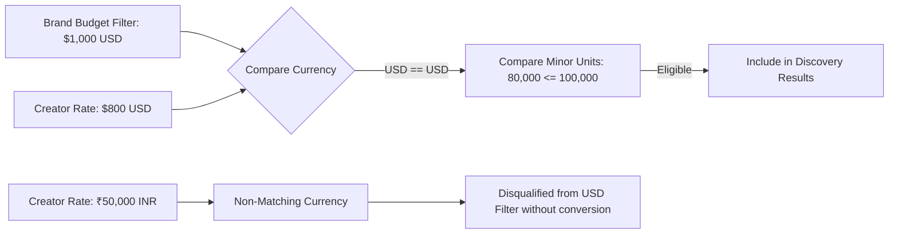
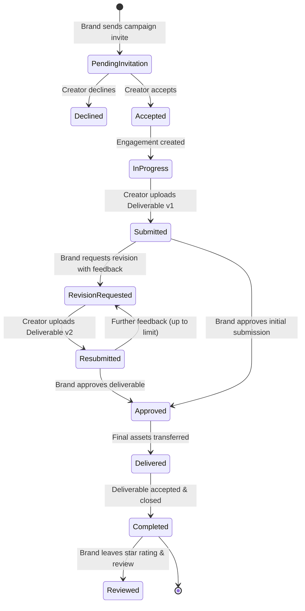

# CreaXa Architecture & Technical Specifications

## 1. System Overview

**CreaXa** is an AI-native content creator marketplace engineered for the next generation of creative production. It bridges AI filmmakers, animators, generative artists, and creative technologists with global brands and creative agencies.

The application is architected around an edge-native, zero-cold-start stack powered by **Vinext** running on the **Cloudflare Workers** runtime, backed by **Cloudflare D1** (distributed SQLite at the edge) and **Cloudflare R2** (S3-compatible object storage).

```mermaid
graph TD
    Client[Web Browser / Mobile Client] -->|HTTPS / WSS| CFEdge[Cloudflare Edge Network]
    CFEdge --> Worker[Cloudflare Worker / Vinext SSR & API Engine]
    
    subgraph "Server-Side Execution Environment"
        Worker --> Auth[Authentication & RBAC Boundary]
        Worker --> Router[Vinext / Next.js 16 App Router]
        Worker --> Matcher[Creator Matching Engine]
        Worker --> AISvc[AI Brief Enhancement Service]
        Worker --> Drizzle[Drizzle ORM Layer]
    end
    
    subgraph "Cloudflare Edge Data Layer"
        Drizzle -->|SQL Queries| D1[(Cloudflare D1 Database)]
        Worker -->|Streaming Put / Get| R2[(Cloudflare R2 Bucket: STORAGE)]
    end
    
    subgraph "External AI Services"
        AISvc -->|HTTPS REST| OpenAI[OpenAI API (GPT-4o / JSON Schema)]
    end
```

---

## 2. Technology Stack & Runtime Profile

| Layer | Technology | Details & Version |
|---|---|---|
| **Core Framework** | Vinext / Next.js 16 | React 19 Server Components (RSC), App Router, Edge runtime |
| **Edge Compute** | Cloudflare Workers | V8 isolates, sub-millisecond cold starts, workerd runtime |
| **Relational Database** | Cloudflare D1 | Distributed SQLite, Drizzle ORM `0.45.2`, 17 tables |
| **Object Storage** | Cloudflare R2 | S3-compatible, multi-part streaming uploads, `STORAGE` binding |
| **Styling & Design System** | Tailwind CSS v4 + Vanilla CSS | CSS custom properties, 10 curated themes, OKLCH/HSL palettes |
| **3D & WebGL Engine** | Three.js `0.186.1` | WebGLRenderer, custom particle fields, camera damping, theme-reactive shaders |
| **Type Safety & Schemas** | TypeScript `5.x` + Zod `3.25.76` | Strict mode, end-to-end schema validation |
| **Testing** | Node test runner + Playwright | End-to-end multi-identity browser automation against real Chrome |

---

## 3. Storage Architecture: Cloudflare R2

Media assets (high-resolution AI concept art, 4K video renders, MP4 motion design, raw project archives) are stored in Cloudflare R2 via the `STORAGE` binding.

### Upload Flow:
1. Client selects file and transmits to `/api/storage/upload` via `multipart/form-data`.
2. Server validates file size (maximum 50MB for video deliverables, 15MB for portfolio imagery).
3. MIME type and magic byte signatures are inspected (supports `image/jpeg`, `image/png`, `image/webp`, `video/mp4`, `video/webm`, `application/pdf`, `application/zip`).
4. Unique immutable key is generated: `${crypto.randomUUID()}-${sanitizedFilename}`.
5. Worker streams the file into R2 using `env.STORAGE.put(key, body, { httpMetadata: { contentType } })`.
6. File metadata record is inserted into D1 `files` table with ownership metadata.
7. Public portfolio items are served via `/api/storage/file?key=${key}` with cache-control headers (`public, max-age=31536000, immutable`).

---

## 4. Multi-Currency Budget Comparison Engine

In an international marketplace, creators set rates in their local currencies (e.g., INR, USD, EUR) while brand briefs specify campaign budgets in target currencies.



### Currency Normalization (`lib/currency.ts`):
- All monetary values are handled in integer minor units (cents, paise) to eliminate floating-point precision errors.
- ISO-4217 standard codes (`INR`, `USD`, `EUR`) are strictly enforced.
- Database discovery queries parameterize `json_extract(data, '$.currency') = ?` alongside `json_extract(data, '$.startingRate') <= ?` to prevent raw numerical cross-contamination (e.g. treating ₹30,000 INR as greater than $300 USD).

---

## 5. Creator Matching Algorithm

The matching engine (`lib/matching.ts`) computes deterministic, explainable compatibility scores (0–100%) between brand campaign briefs and creator profiles based on 7 weighted dimensions:

$$\text{Match Score} = \sum_{i=1}^{7} W_i \times S_i$$

| Dimension | Weight ($W_i$) | Matching Logic |
|---|---|---|
| **Specialization** | 25% | Direct match on primary creative discipline |
| **Skills** | 20% | Jaccard overlap on specific techniques (e.g. LoRA training, ControlNet, Inpainting) |
| **AI Tools** | 20% | Overlap on generative model stacks (Midjourney v6, Runway Gen-3, Flux.1, ComfyUI, Kling) |
| **Creative Style** | 15% | Semantic alignment on visual style (Photorealistic, Cyberpunk, Neo-Editorial, Anime) |
| **Content Formats & Ratios** | 10% | Support for requested deliverables (9:16 Vertical Video, 16:9 4K Film, 1:1 Social Stills) |
| **Budget Compatibility** | 5% | Currency-aware minor unit rate eligibility |
| **Verification & Rating** | 5% | Creator trust tier and client review history |

---

## 6. End-to-End Collaboration State Machine

Collaboration engagements follow a strict transactional state machine enforced on both API and database layers:



---

## 7. Dynamic Three.js WebGL Architecture

The hero presentation utilizes a responsive Three.js canvas (`app/components/home-intro.tsx`):
- **Rendering Pipeline:** WebGLRenderer with high-DPI scaling (`Math.min(window.devicePixelRatio, 2)`).
- **Scene Composition:** 5,600 floating particle elements in a helical geometry, central holographic generative prism, and subtle ambient/directional lighting.
- **Theme Reactivity:** Dynamic color uniform updates on theme switch without recreating the WebGL context or causing memory leaks.
- **Performance & Fallback:** Degrades gracefully to an elegant static CSS mesh gradient if WebGL context is unavailable or fails hardware initialization.
